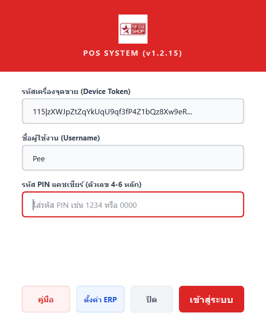
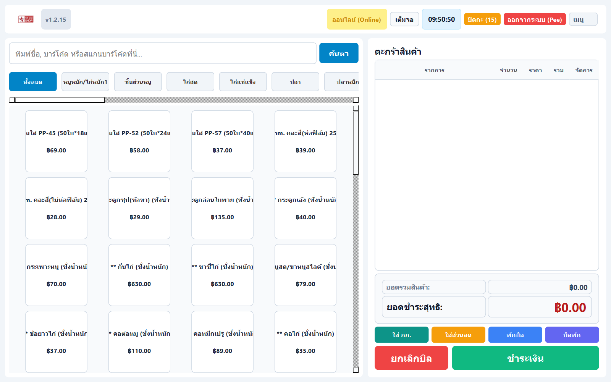
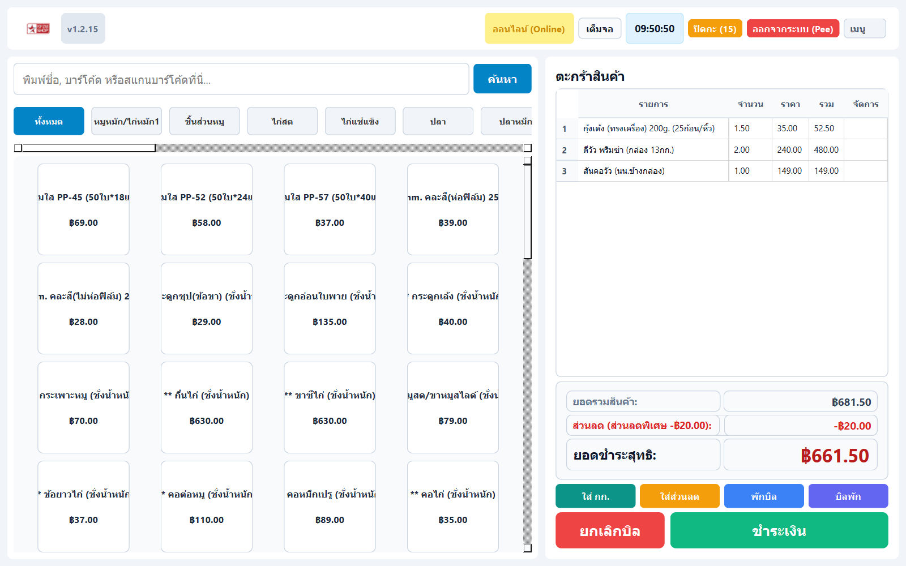
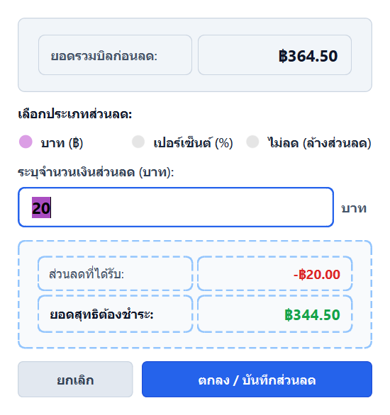
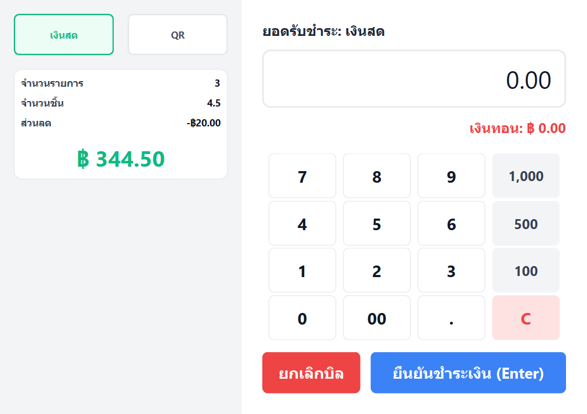
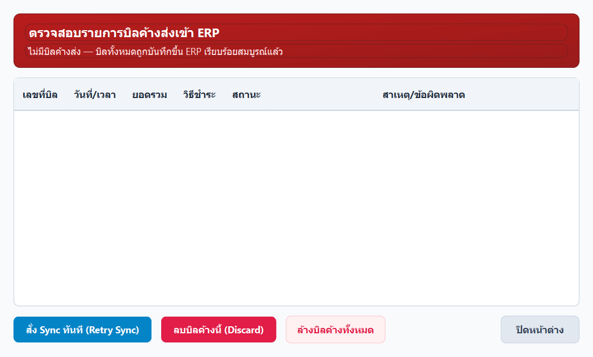

# PopCentral POS (v1.2.18)

ระบบจุดขายหน้าร้านระดับพาณิชย์ (Commercial Desktop POS) พัฒนาด้วย **Python (PySide6 / Qt6)** และ **SQLAlchemy (SQLite)** ออกแบบตามสถาปัตยกรรม **Local-First & Offline-First** สามารถเปิดบิล ขายสินค้า ชั่งน้ำหนัก พิมพ์ใบเสร็จ และรับชำระเงินได้ตลอดเวลาแม้ไม่มีสัญญาณอินเทอร์เน็ต พร้อมระบบ Background Sync อัตโนมัติที่เชื่อมต่อกับ **PopStar ERP Backend**

---

## จุดเด่นของระบบ (Key Features)

- **Local-First Architecture**: ฐานข้อมูล SQLite ในเครื่อง (`%LOCALAPPDATA%\PopCentralPOS\data\pos.db`) ทุกรายการขายจะถูกบันทึกลงเครื่องอย่างสมบูรณ์ก่อนเสมอ ป้องกันข้อมูลสูญหาย 100%
- **Auto Background Synchronization**: ระบบ Worker คอยตรวจสอบสัญญาณอินเทอร์เน็ตและส่งข้อมูลบิลขาย (Outbox Queue) เข้า ERP เซิร์ฟเวอร์แบบ Real-time พร้อมระบบป้องกันบิลซ้ำ (Idempotency Key)
- **เครื่องชั่งน้ำหนักและบาร์โค้ดสินค้าสด (Scale Integration)**: รองรับการอ่านบาร์โค้ดเครื่องชั่งทั้งแบบ Prefix ในร้าน (`800`, `801`, `02`, `20`) และ EAN-13 มาตรฐาน พร้อมระบบแปลงน้ำหนักและราคาอัตโนมัติ
- **ระบบรับชำระเงินครบวงจร (Multi-payment)**:
  - รับเงินสด (Cash) พร้อมคำนวณเงินทอนอัตโนมัติ
  - สแกน QR PromptPay พร้อมระบบสร้าง Dynamic QR ตามยอดเงินจริง
  - บัตรเครดิต และการชำระเงินแบบผสม (Split Payment: เงินสด + โอน)
  - ระบบส่วนลดท้ายบิลและส่วนลดสินค้า คำนวณยอดสุทธิและเงินทอนแม่นยำ
- **ระบบเปิดลิ้นชักด้วยรหัส PIN (Drawer PIN Protection)**: การกดปุ่มหรือคำสั่งเปิดลิ้นชักเก็บเงิน จะต้องระบุรหัส PIN ของแคชเชียร์ก่อนเปิดเสมอ พร้อมรองรับ Touch Keypad บนหน้าจอและคีย์บอร์ดจริง
- **ปุ่มเต็มจอฝั่งลูกค้า (Customer Display Fullscreen Button)**: หน้าต่างแสดงผลสำหรับลูกค้า (Secondary Display) มีปุ่มกด "เต็มจอ" (Fullscreen) และ "ย่อจอ" ปรับขนาดหน้าจอได้ทันที
- **ฟังก์ชันชั่งน้ำหนักเฉพาะสินค้าประเภทชั่งน้ำหนัก (Scale Weight Restriction)**: ปุ่ม "ใส่ กก." และหน้าต่างระบุกิโลกรัมจะกรองและอนุญาตเฉพาะสินค้าประเภทชั่งน้ำหนักเท่านั้น ป้องกันการนำไปใช้กับสินค้าที่ขายนับเป็นชิ้น
- **ระบบความปลอดภัยแคชเชียร์ (PIN Authentication)**:
  - เข้าใช้งานด้วยรหัส PIN รวดเร็ว ปลอดภัย ไม่ต้องพิมพ์รหัสผ่านยาว
  - จดจำชื่อผู้ใช้ล่าสุดและโฟกัสช่องกรอก PIN ทันที
- **การจัดการกะและรายงาน (Shift & Cash Management)**:
  - บันทึกเงินทอนเริ่มต้นกะ (Opening Cash)
  - รายงานสรุปยอดขายประจำวันและสรุปกะ (Z-Report)
  - ปิดกะพร้อมนับเงินสดจริงและคำนวณยอดเงิน ขาด/เกิน
- **พิมพ์ใบเสร็จและลิ้นชักเก็บเงิน (Thermal Receipt Printer)**:
  - รองรับเครื่องพิมพ์ความร้อน 80mm และ 58mm (ESC/POS, Windows Driver)
  - หน้าต่างตั้งค่าเครื่องพิมพ์พร้อมระบบแสดงตัวอย่างใบเสร็จสด (Live Preview)
  - ปรับขนาดตัวอักษรใบเสร็จได้ (มาตรฐาน / ตัวใหญ่ ชัดเจน)
- **ระบบสำรองข้อมูลอัตโนมัติ (Auto Backup)**:
  - สำรองฐานข้อมูล SQLite อัตโนมัติทุกวันเมื่อเริ่มโปรแกรม ป้องกันเหตุฉุกเฉิน

---

## ความต้องการของระบบ (System Requirements)

| รายการ | ความต้องการขั้นต่ำ | แนะนำ |
|---|---|---|
| **ระบบปฏิบัติการ (OS)** | Windows 10 (64-bit) | Windows 11 (64-bit) |
| **หน่วยประมวลผล (CPU)** | Intel Core i3 / AMD Ryzen 3 | Intel Core i5 หรือเทียบเท่า |
| **หน่วยความจำ (RAM)** | 4 GB | 8 GB ขึ้นไป |
| **พื้นที่ว่างบนฮาร์ดดิสก์** | 500 MB | 2 GB ขึ้นไป (SSD) |
| **เครื่องพิมพ์ใบเสร็จ** | Thermal Printer 58mm / 80mm | Xprinter, Epson, POS-80 |

---

## คู่มือและวิธีติดตั้งโปรแกรม (Installation Guide)

สามารถดาวน์โหลดไฟล์ติดตั้งเวอร์ชันล่าสุดได้จากเมนู [Releases (v1.2.18)](https://github.com/nongpee321/posCentral/releases/tag/v1.2.18)

### ตัวเลือกที่ 1: ติดตั้งแบบตัวติดตั้งอัตโนมัติ (.exe Setup) — แนะนำสำหรับเครื่องหน้าร้าน

1. ดาวน์โหลดไฟล์ `PopCentral-POS-UAT-1.2.18-setup.exe`
2. ดับเบิลคลิกเปิดไฟล์ติดตั้ง
3. เลือกตำแหน่งติดตั้ง (ค่าเริ่มต้น: `C:\PopCentral POS` หรือ `D:\PopCentral POS`)
4. กดปุ่ม **Extract** หรือ **ติดตั้ง**
5. ตัวติดตั้งจะทำการวางไฟล์และสร้างทางลัดไอคอน **PopCentral POS** บนหน้าจอ Desktop ให้ทันที

### ตัวเลือกที่ 2: ใช้งานแบบ Portable (.zip ไม่ต้องติดตั้ง)

1. ดาวน์โหลดไฟล์ `PopCentral-POS-Central-UAT-1.2.18-portable.zip`
2. คลิกขวาที่ไฟล์ `.zip` แล้วเลือก **Extract All... (แตกไฟล์ทั้งหมด)** ไปยังโฟลเดอร์ที่ต้องการ เช่น `D:\PopCentral-POS-Central-UAT`
3. ดับเบิลคลิกไฟล์ `PopCentral-POS-Central-UAT.exe` เพื่อเปิดใช้งานได้ทันที

---

## คู่มือการใช้งานโปรแกรมและรูปภาพขั้นตอนการทำงาน (User Manual & Screenshots)

### 1. การลงทะเบียนเครื่องจุดขายครั้งแรก (First-time Device Token Setup)

เมื่อเปิดโปรแกรมครั้งแรกบนเครื่องใหม่ ระบบจะเปิดหน้าต่าง **ลงทะเบียนเครื่องจุดขาย**:



1. **รหัสเครื่องจุดขาย (Device Token)**: กรอกรหัส Token ที่ได้รับจากผู้ดูแลระบบ ERP
2. **ชื่อผู้ใช้งาน (Username)**: ใส่ชื่อผู้ใช้แคชเชียร์ เช่น `Pee`
3. **รหัส PIN แคชเชียร์**: กำหนดรหัส PIN ตัวเลข 4-6 หลัก
4. กดปุ่ม **"เข้าสู่ระบบ"** (หรือกดปุ่ม "ตั้งค่า ERP" หากต้องการตรวจสอบ URL เช่น `https://erp.popstarcenter.com`)
5. ระบบจะดึงฐานข้อมูลสินค้า สาขา และโปรโมชั่นจาก ERP ลงสู่เครื่องอัตโนมัติ

---

### 2. การเข้าสู่ระบบแคชเชียร์ประจำวัน (Daily Cashier PIN Login)

สำหรับการเข้างานประจำวันหรือสลับกะพนักงานขาย:


1. ระบบจะจดจำชื่อผู้ใช้งานเดิมให้อัตโนมัติ
2. กรอก **รหัส PIN แคชเชียร์** (เช่น `1234` หรือ `0000`)
3. กดปุ่ม **"เข้าสู่ระบบ"** หรือกดปุ่ม `Enter` บนคีย์บอร์ด

---

### 3. การเปิดกะขายสินค้า (Open Shift)

ก่อนเริ่มคิดเงินบิลแรกของวัน แคชเชียร์ต้องเปิดกะขาย:


1. ตรวจสอบชื่อสาขาและชื่อแคชเชียร์ให้ถูกต้อง
2. ระบุยอด **เงินทอนเริ่มต้น** ในลิ้นชักเก็บเงิน (เช่น `1000` บาท หรือ `0` หากไม่มีเงินทอน)
3. กดปุ่ม **"เปิดกะ"** เพื่อเริ่มขายสินค้า

---

### 4. หน้าต่างขายสินค้าหลัก (Main Sales Screen & Catalog)

หน้าจอหลักสำหรับการขายสินค้า แคตตาล็อกแบ่งตามหมวดหมู่ชัดเจน:



1. **แถบสถานะด้านบน**: แสดงเวอร์ชัน `v1.2.18`, สถานะ `ออนไลน์ (Online)`, นาฬิกา, ปุ่มปิดกะ, และปุ่มเมนู
2. **ค้นหาและสแกนสินค้า**: ยิงบาร์โค้ด หรือพิมพ์ค้นหาชื่อสินค้า/รหัสสินค้า
3. **หมวดหมู่สินค้า**: เลือกดูสินค้าตามประเภท เช่น หมูหมัก, ชิ้นส่วนหมู, ไก่สด, ไก่แช่แข็ง, ปลา, อาหารทะเล ฯลฯ

---

### 5. ตะกร้าสินค้าและการคำนวณส่วนลดบิล (Cart & Discount Calculation)

เมื่อเลือกสินค้าลงตะกร้า ระบบจะคำนวณยอดรวม และรองรับการใส่ส่วนลด:



1. **รายการในตะกร้า**: แสดงลำดับ, รายการ, จำนวน (กก./แพ็ค), ราคาต่อหน่วย, และราคารวม
2. **ยอดรวมสินค้า**: แสดงยอดรวมก่อนหักส่วนลด
3. **ส่วนลด**: แสดงยอดส่วนลดที่ได้รับเป็นตัวอักษรสีแดงชัดเจน
4. **ยอดชำระสุทธิ**: คำนวณยอดเงินที่ลูกค้าต้องจ่ายจริงหลังหักส่วนลด

---

### 6. หน้าต่างใส่ส่วนลดบิล (Discount Dialog)

กดปุ่มสีส้ม **"ใส่ส่วนลด"** เพื่อเปิดหน้าต่างกำหนดส่วนลด:



1. เลือกประเภทส่วนลด: **บาท (฿)** หรือ **เปอร์เซ็นต์ (%)**
2. ระบุจำนวนเงินส่วนลด
3. ระบบจะคำนวณยอดสุทธิที่ต้องชำระให้ดูสดทันที
4. กดปุ่ม **"ตกลง / บันทึกส่วนลด"**

---

### 7. หน้าต่างคิดเงินและรับชำระเงิน (Payment Screen)

กดปุ่มสีเขียว **"ชำระเงิน"** เพื่อเข้าสู่หน้าต่างรับเงิน:



1. **เลือกช่องทางชำระเงิน**: **เงินสด** หรือ **QR Code PromptPay**
2. **ระบุยอดเงินสดที่รับ**: กดปุ่มลัด (100, 500, 1,000) หรือคีย์ตัวเลข
3. **คำนวณเงินทอนอัตโนมัติ**: ระบบแสดงยอดเงินทอนสีแดงชัดเจน
4. กดปุ่ม **"ยืนยันชำระเงิน (Enter)"** ระบบจะพิมพ์ใบเสร็จความร้อน ลิ้นชักเด้ง และบันทึกยอดขายทันที

---

### 8. ตรวจสอบสถานะการส่งข้อมูลเข้า ERP (Sync Monitor)

หน้าต่างตรวจสอบบิลขายและการส่งข้อมูลเข้าเซิร์ฟเวอร์ส่วนกลาง:



1. **ระบบ Auto-Sync**: บิลขายจะถูกส่งเข้า ERP เซิร์ฟเวอร์แบบ Real-time ในเบื้องหลัง
2. **ปุ่มสั่ง Sync ทันที (Retry Sync)**: สำหรับสั่งส่งข้อมูลซ้ำกรณีเน็ตหลุด
3. **ปุ่มลบบิลค้าง (Discard)**: สำหรับจัดการบิลกรณีมีข้อผิดพลาด

---

## วิธีติดตั้งจาก Source Code (สำหรับ Developer)

```bash
# 1. Clone repository
git clone https://github.com/nongpee321/posCentral.git
cd posCentral

# 2. สร้างและเปิดใช้งาน venv
python -m venv venv
.\venv\Scripts\Activate.ps1

# 3. ติดตั้งไลบรารี
pip install -r requirements.txt
pip install -r requirements-dev.txt

# 4. ทดสอบระบบ
python -m pytest tests -v

# 5. รันโปรแกรม
python main.py
```

---

## วิธี Build ตัวติดตั้ง (.exe) ด้วยตนเอง

```powershell
powershell -ExecutionPolicy Bypass -File .\build_pos.ps1 -Version "1.2.18"
```
ไฟล์ติดตั้งสำเร็จรูปจะถูกสร้างไว้ที่ `dist\PopCentral-POS-UAT-1.2.18-setup.exe`

---

## License

Proprietary Software - สงวนลิขสิทธิ์ บริษัท ป๊อปสตาร์ฟู้ดส์ เทรดดิ้ง จำกัด (Pop Star Food Trading Co., Ltd.)
