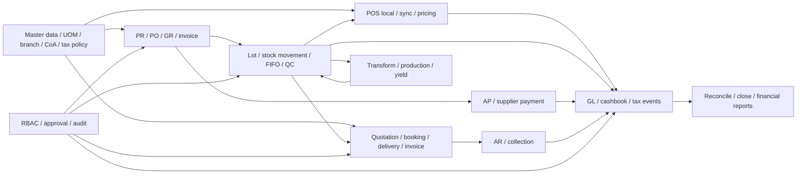
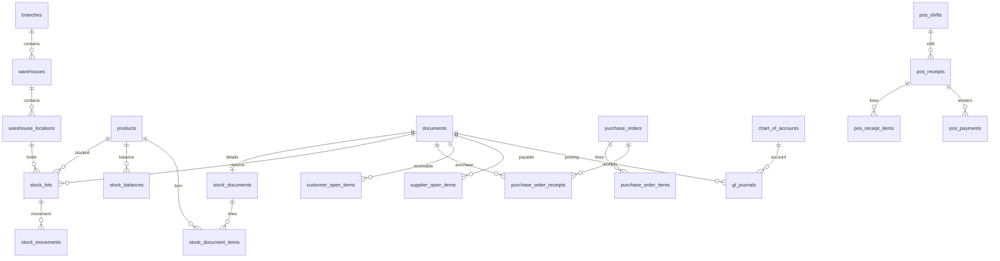

# วิเคราะห์ Bplus ERP เทียบ POPSTAR ERP/POS

วันที่ 2026-11-06 · Branch `claude/bplus-erp-analysis` · ฐานตรวจ `140deb0` (HEAD ก่อนเขียน)

## 1. Executive Summary

**ควรยกระดับความถูกต้องของสต๊อก ต้นทุน บัญชี และคิว POS ก่อนเพิ่มโมดูลตามรายการของ Bplus** ระบบนี้มีธุรกรรมหลักค่อนข้างมากแล้ว: รับซื้อ/รับ PO บางส่วน, ใบจอง, ขายสด/เชื่อ, AR/AP, FIFO/FEFO, lot/expiry/QC/recall, แปรรูป, GL, งบการเงิน และ POS offline การมี service, route หรือ test เป็นหลักฐานว่ามี implementation ไม่ใช่หลักฐานว่าผ่าน UAT หรือใช้งาน production สมบูรณ์

| ลำดับ | สิ่งที่ควรตัดสินใจ | ผลต่อธุรกิจอาหารสด/แช่แข็งหลายสาขา |
|---|---|---|
| P0 | ให้เอกสาร posted และต้นทุนมี reversal/variance journal ที่ตรวจย้อนหลังได้ | ลดสต๊อกมูลค่าไม่ตรง GL และกำไรย้อนหลังเปลี่ยน |
| P0 | รับรองคิว POS ทั้งสอง client ด้วย replay, crash recovery และ server pricing | ลดบิลตกหล่น รายได้/เงินสดซ้ำ และผลต่างหลัง reconnect |
| P0 | แยก stock ระหว่างทางจากพร้อมขายปลายทาง และทดสอบอนุมัติซ้ำพร้อมกัน | ป้องกันขายของที่ยังมาไม่ถึงและโอนซ้ำ |
| P1 | แยก GR, supplier invoice และ tax event; จับคู่ PO–GR–Invoice | ไม่ตั้ง AP/VAT ผิดเวลาเพราะถือว่ารับของเท่ากับได้ใบกำกับ |
| P1 | คุม lot/expiry, yield, loss, ราคาตามหน่วยและวงเงินลูกค้าครบทุกช่องทาง | เห็นกำไรจริง ลดของเสียและความเสี่ยงหนี้ |
| P2 | ขยาย MRP, forecast, profit center ก่อน consolidation/HRM เต็มรูปแบบ | ลงทุนตามปัญหาจริง ไม่สร้างหน้าจอที่ไม่มี posting rule รองรับ |

หลักฐานสำคัญ: PO บางส่วน `app/Services/Purchasing/PurchaseOrderReceivingService.php:23`; FIFO/FEFO `app/Services/Inventory/FifoStockService.php:91`; ต้นทุนจริง `app/Services/Inventory/CostingService.php:88`; POS replay `app/Http/Controllers/Api/PosApiController.php:583`; งบ `app/Http/Controllers/FinancialStatementController.php:18`.

ข้อจำกัด: เปิด YouTube ไม่สำเร็จ จึงไม่มีข้ออ้างที่ยืนยันจากภาพ/เสียงหรือนาทีคลิป; ใช้สรุปเจ้าของตาม brief เท่านั้น ไม่ตรวจฐาน production/MSSQL และไม่แก้โค้ด/migration/deploy. `git pull origin main` ล้มเหลว `FETCH_HEAD: Operation not permitted` จึงไม่รับรองว่า HEAD ทัน remote ปัจจุบัน. ข้อมูล POS ขัดกัน: brief ระบุ Vue production 1.8.1/Python UAT 0.8.x ขณะที่ memory บอก Python เป็นหลัก; `apps/pos-desktop/package.json:4` เป็น 1.7.9 และ release workflow ยัง build Vue (`.github/workflows/pos-desktop-release.yml:31`), Python มี UAT workflow (`.github/workflows/pos-python-windows-uat.yml:40`). สรุปได้เพียงว่ามีสองสาย build; ต้องตรวจ artifact hash/รุ่นบนเครื่องจริงก่อน cutover.

## 2. Bplus ERP Feature Breakdown

แหล่งที่ได้รับ: [คลิปที่เจ้าของระบุ](https://www.youtube.com/watch?v=XU7vllpI8TI) และ `docs/ai/codex-bplus-erp-analysis-brief.md` ส่วน “สรุปคลิปจากเจ้าของ”. ไม่คัดลอก UI, schema หรือองค์ประกอบกรรมสิทธิ์

| กลุ่ม | ข้อเท็จจริงจากคลิป | ข้อมูลตามสรุปเจ้าของ (ยังไม่ยืนยันจากคลิป) | การตีความ | ข้อเสนอใหม่ของเรา |
|---|---|---|---|---|
| ผลิตภัณฑ์ | ยืนยันเองไม่ได้ | ERP, POS โปร/สมาชิก/แต้ม, Mobile Sales, HRM | แยกช่องทางขายกับระบบกลาง | กำหนด owner ของราคา/สิทธิ์/ยอดคงเหลือ |
| จัดซื้อ/คลัง | ยืนยันเองไม่ได้ | PR/PO/GR, partial, WMS, PDA, นับ offline, assembly, transformation, MRP | ต้องมีสถานะและยอดคงค้างรายบรรทัด | GRNI, in-transit, dual-weight, lot lineage |
| การเงิน/บัญชี | ยืนยันเองไม่ได้ | AR/AP, cash, bank rec, assets, VAT/WHT, e-Tax, FS | การลงบัญชีอัตโนมัติต้องมี event ที่ชัด | posting contract และ reconciliation ก่อนรายงาน |
| ต้นทุน/วางแผน | ยืนยันเองไม่ได้ | FIFO, average, lot/serial, landed cost, ABC/EOQ | แต่ละวิธีมีฐานคำนวณต่างกัน | FIFO ledger + average เพื่อวิเคราะห์ แยกบทบาท |
| ควบคุมเอกสาร | ยืนยันเองไม่ได้ | วงเงิน อนุมัติ ผู้อนุมัติแทน ป้องกันทุจริต | ต้องแยกผู้ทำ/อนุมัติและสาขา | delegation มีวันเริ่ม/หมดอายุ ไม่ให้สิทธิ์ถาวร |
| ผู้บริหาร/สถาปัตย์ | ยืนยันเองไม่ได้ | dashboard, profit center, consolidation, cash flow; mobile ผ่าน web server | ไม่ได้เปิดเผย topology หรือเทคโนโลยีจริง | API กลาง ไม่มี mobile ต่อ DB ตรง; แยกบริษัทกับสาขา |

## 3. Gap Analysis จาก repo จริง

คำว่า “ยังไม่มี” ด้านล่างหมายถึง **ไม่พบ implementation ครบในขอบเขตไฟล์ที่ตรวจ** ไม่ใช่พิสูจน์ว่าไม่มีในทุก branch. ระดับความเสี่ยงเป็นการประเมินจากโค้ด ไม่ใช่รายงานความเสียหายที่เกิดจริง; จำนวนเงินที่ยกเป็นตัวอย่างสมมติ

| โมดูล/สถานะ | หลักฐานไฟล์:บรรทัด | ช่องว่าง/ความเสี่ยงและผลกระทบ | ควรทำก่อน |
|---|---|---|---|
| ERP core — มีแล้ว | `composer.json:8`, `composer.json:9`, `phpunit.xml:27` | Laravel ^13.8/PHP ^8.3; test SQLite ไม่พิสูจน์ PostgreSQL production | P0 ตรวจ DB parity |
| PR/PO/partial — มีแต่ไม่ครบวงจร | `database/migrations/2024_01_01_000095_create_purchase_orders_table.php:15`, `app/Services/Purchasing/PurchaseOrderReceivingService.php:24`, `:55` | ใช้ PO มีผู้ขอ/อนุมัติและรับผ่าน PurchaseService; ยังไม่ใช่ PR แยกหลายใบรวม PO + invoice matching อิสระ; กลาง: รับของแล้วตั้งหนี้เร็วกว่าหลักฐานจริง | P1 |
| FIFO/FEFO/QC — มีแล้ว | `app/Services/Inventory/FifoStockService.php:39`, `:74`, `:91`; `docs/OPERATIONS.md:40` | มี lock lot และกันหมดอายุ/จำกัดคุณภาพ; กลาง: ต้อง UAT วันที่ย้อนหลังและ recall ข้ามแปรรูป | P0 รับรอง |
| โอน/ตรวจรับ — มีแต่ไม่มี stock in-transit จริง | `app/Services/Inventory/StockTransferService.php:46`, `:178`; `app/Services/Inventory/StockTransferReceiptService.php:13` | สูง: approve ออกต้นทางและรับปลายทางทันที; ตรวจรับเป็นหลักฐานไม่ขยับ stock; โอน 100 กก.×100 บาททำให้ 10,000 บาทพร้อมขายก่อนรับจริง | P0 |
| อนุมัติโอนซ้ำ — เสี่ยง | `app/Services/Inventory/StockTransferService.php:46` | สูง: service approve ไม่ lock เอกสาร/ตรวจ pending ภายในเอง; ต้องพิสูจน์ controller และ concurrent request ก่อนฟันธง exploit; ผลอาจโอนซ้ำทั้งจำนวนและมูลค่า | P0 concurrency test |
| นับ/ปรับ — มีแล้ว | `app/Services/Inventory/StockCountService.php:88`, `app/Services/Inventory/StockAdjustmentService.php:115` | กลาง: ต้องตรวจ count snapshot กับการขายระหว่างนับ; นับ offline หลายเครื่องยังต้องมี conflict contract | P1 |
| FIFO เทียบ average — มีแล้วแต่ต้องสื่อสาร | `app/Services/Inventory/CostingService.php:15`, `:31`, `:88` | กลาง: average ระดับ product รวม stock หลาย location ใช้วิเคราะห์; GL COGS จาก allocation จริง อย่าใช้ average แทน FIFO ในรายงาน | P0 reconciliation |
| ปรับต้นทุน/landed cost — มีบางส่วนและเสี่ยง | `app/Services/Inventory/PurchaseCostAdjustmentService.php:15`, `:47`, `:65` | สูง: เปลี่ยน lot cost/average แต่ไม่ลง GL/AP/ต้นทุนขายเดิม; คงเหลือ 60 กก.เพิ่มทุน 10 ทำให้ subledger เพิ่ม 600 โดย GL เดิม; consumed 40 มี variance 400 รอตัดสินใจ; ยังไม่ใช่ landed-cost allocation ครบ | P0 |
| Posted immutability — มี reversal แต่ยังไม่รับรอง | `app/Services/Accounting/GlPostingService.php:212`, `:230`, `:345` | สูง: postDocument ลบ GL เดิมก่อนสร้างใหม่ จึงไม่ใช่ append-only contract; ไม่ได้แปลว่าผู้ใช้แก้ posted ผ่าน UI ได้แน่ แต่ควรปิดช่อง repost ที่ลบประวัติ | P0 |
| ขาย/ส่ง/AR — มีแต่ partial ต้องแยกความหมาย | `app/Services/Sales/BookingDeliveryService.php:28`, `:48`; `app/Services/Sales/CreditSaleService.php:47` | กลาง: partial delivery status ไม่ใช่ invoicing รายบรรทัด; conversion lock ใบจองและคัดลอกรายการทั้งใบ ต้องยืนยัน orchestration ว่ารอส่งครบทุก entry point | P1 |
| คืน/ลดหนี้ — มีแล้ว | `app/Services/Sales/SaleCreditLimit.php:11`, `app/Services/Sales/SaleReturnService.php:335` | กลาง: shared refund ceiling กับ source sale ต้องทดสอบ return+CN พร้อมกัน; ห้ามใช้ยอด AR ค้างแทนเพดานคืน | P0 |
| โปร/ราคาขาย/ขายส่ง — มีแล้วบางส่วน | `app/Services/Sales/PosPricingGuard.php:107`, `:179`, `:323`, `:380`; `database/migrations/2024_01_01_000066_create_price_tables_table.php:12` | กลาง: ต้องพิสูจน์ customer price กับหน่วย/โปรและเอกสารขายหลังบ้านให้เท่ากัน; ยังไม่รับรอง credit exposure แบบ atomic ทุกช่องทางจากไฟล์ที่อ่าน | P1 |
| GL/AR/AP/FS — มีแล้ว | `app/Services/Accounting/GlPostingService.php:24`, `:103`, `:279`, `:375`; `app/Http/Controllers/FinancialStatementController.php:18` | กลาง: การมี TB/BS/P&L ไม่รับรองมาตรฐานงบและยอด opening; ต้อง reconcile subledger | P0 |
| VAT/WHT/e-Tax — มีแต่ไม่สมบูรณ์ | `app/Services/Accounting/TaxComplianceService.php:18`, `:68`, `:85`, `:119` | สูง: CSV prepared และ provider-neutral JSON ไม่ใช่หลักฐานยื่นผ่าน; VAT ใช้ doc_date ขณะ WHT supplier ใช้ paid_on ต้องตรวจ tax point และ state filter | P0 ภาษี |
| Bank/assets/period — มีแล้ว | `tests/Feature/BankReconciliationTest.php:1`, `app/Services/Accounting/DepreciationService.php:1`, `app/Services/Accounting/AccountingPeriodGuard.php:12` | กลาง: ต้องตรวจ reconcile statement, เสื่อมซ้ำและปิดงวดข้ามสาขาจริง | P1 |
| แปรรูป/assembly — มีแล้วบางส่วน | `app/Services/Inventory/StockTransformService.php:39`, `:236`; `app/Services/Inventory/ProductionReceiptService.php:32` | กลาง: มี actual weight/recipe/FIFO input; ยังไม่ใช่ MRP capacity planning เต็มรูปแบบ | P1 |
| Serial/catch weight — มีแต่ยังไม่ครบ | `database/migrations/2024_01_01_000027_create_stock_document_items_table.php:22`, `app/Services/Inventory/StockTransformService.php:236` | กลาง: serial_no field ไม่ใช่ serial lifecycle uniqueness; ชั่งถุงจริงไม่เท่ากับ dual-unit piece+kg ตลอดสาย | P2 |
| POS offline — มีแล้วแต่ parity ต่างกัน | `apps/pos-desktop/src/lib/sync.ts:7`, `apps/pos-python/pos_python/sync_service.py:56`, `app/Http/Controllers/Api/PosApiController.php:603` | สูง: Vue queue checkout กับ Python outbox หลาย event คนละ contract; ไม่ควรสลับ installer ก่อน migration ที่คงบิล/กะค้าง | P0 |
| สิทธิ์/วงเงินอนุมัติ — มีแต่ delegation ยังไม่พบครบ | `app/Services/Documents/ApprovalPolicyService.php:12`, `:25` | กลาง: มี branch/maker/amount rule และ admin exception; ต้องอนุมัตินโยบาย exception และออกแบบผู้แทนที่หมดอายุ | P1 |
| Dashboard/profit center/consolidation — มีบางส่วน | `app/Http/Controllers/ManagementControlController.php:24`, `database/migrations/2026_07_19_000125_add_management_growth_modules.php:12`, `app/Http/Controllers/FinancialStatementController.php:35` | กลาง: branch profit/cost center ไม่เท่ากับ GL dimension/หลายบริษัทและ elimination; ยังไม่พบ consolidation ครบ | P2/P3 |
| HRM/E-commerce/Mobile — มีบางส่วน | `database/migrations/2026_07_19_000125_add_management_growth_modules.php:48`, `:87`; `routes/web.php:234` | ต่ำต่อยอดขายทันที: มี attendance/payroll/ecommerce schema และ mobile warehouse routes ไม่ยืนยัน integration marketplace/mobile sales ครบ | P3 |
| Legacy Bplus — มี read/import tools | `app/Console/Commands/BplusPriceSync.php:38`, `app/Console/Commands/BplusMemberSync.php:30` | สูงถ้าใช้ผิด: SELECT legacy อาจตามด้วยเขียน ERP; ห้ามรัน sync ในงานวิเคราะห์และห้ามรวม legacy sale ซ้ำ | P0 boundary |

## 4. ERP Module Dependency Map

ทิศลูกศรคือ dependency/ข้อมูล ไม่ใช่ทุกกล่องมี API หรือเสร็จสมบูรณ์แล้ว. Master data ต้องผ่านก่อนรับของ/ขาย; ต้นทุนต้องผ่านก่อนกำไร; subledger ต้องผ่านก่อนปิดงวด; profit center ก่อน consolidation

### สัญญาโมดูลร่วมสำหรับข้อ 4–14

ตาราง A–C เป็นนิยามเดียวกันที่ใช้ทุกหัวข้อ 4–14 เพื่อไม่เขียน 12 ช่องซ้ำทุกหน้า. แถว M1–M12 ครอบคลุมโมดูลทั้งหมด; “เสนอ” คือสิ่งที่จะพัฒนา ไม่ใช่ endpoint/schema/permission ที่มีแล้ว. ทุกโมดูลต้องมี test และ acceptance เฉพาะแถวใน C ร่วมกับข้อ 14

**A: Business Objective, Inputs, Outputs, Business Rules, Database Tables**

| ID/โมดูล | Objective | Inputs → Outputs | Rules | Tables ปัจจุบัน; เสนอเพิ่ม |
|---|---|---|---|---|
| M1 Master/องค์กร | หน่วย ราคา สาขา บัญชีตรงกัน | SKU/UOM/tax/customer → versioned catalog | factor>0, barcode active เดียว, branch assignment มีอายุ | products, product_units, product_barcodes, branches, warehouses, warehouse_locations, chart_of_accounts; เสนอ catalog_versions |
| M2 Purchasing | รับครบตามสั่งไม่ตั้งหนี้ซ้ำ | request/PO/lot/invoice → GR/AP/match | partial≤outstanding; ไม่รับ AP ซ้ำตอน invoice | purchase_orders/items/receipts, documents, stock_document_items, supplier_open_items; เสนอ purchase_requisitions/items, supplier_invoices/items, invoice_receipt_matches |
| M3 Sales/pricing/AR | ขายตามราคาและวงเงิน | quote/booking/delivery/customer → invoice/open item | จองไม่ใช่รายได้; tax point แยก; return≤source remaining | quotations/items, sale_bookings, documents, customer_open_items, price_tables, promotions; เสนอ sales_fulfillment_lines, credit_reservations |
| M4 Inventory/QC/serial | คงเหลือและติดตาม lot ถูก | receipt/issue/quality → lot/movement | FEFO สินค้าหมดอายุ, ห้ามขาย quarantine | stock_balances/lots/movements, stock_lot_lineages, recall_cases; เสนอ stock_serials, serial_movements, dual_quantity_measurements |
| M5 Transfer/count/adjust | โอนและนับมีผู้รับผิดชอบ | shipment/scan/count → receipt/approved variance | in-transit ยังไม่พร้อมขาย; maker≠checker | stock_documents/items, stock_transfer_receipts/items, stock_counts/items; เสนอ stock_shipments/items, count_sync_events |
| M6 Cost/production/MRP | ทุนจริงและ yield โปร่งใส | lot input/recipe/freight/output → allocations/batch/variance | Σinput value+เพิ่ม=Σoutput+loss; ห้ามเขียนทุน posted ทับ | production_recipes/items, production_orders/items, production_batches/packages, purchase_cost_adjustments, inventory_cost_closes; เสนอ landed_cost_allocations, cost_variance_postings, mrp_runs |
| M7 POS/member | ขาย local ไม่สูญหาย/ไม่ซ้ำ | scan/PIN/tender/UUID → receipt/outbox/review | persist ก่อน print; server ตรวจราคาและ actor | pos_receipts/items/payments, pos_shifts, pos_offline_sales, pos_api_idempotency, members, member_point_transactions; local SQLite outbox/queue |
| M8 Finance/cash/bank | เงินและหนี้กระทบยอดได้ | allocation/statement → payment/reconciliation | จัดสรรไม่เกินหนี้; bank match ครั้งเดียว | payment_documents/lines/allocations, supplier_open_items, cash_books, bank_statements, bank_reconciliations, cheques; เสนอ cash_forecast_versions |
| M9 Accounting/tax/assets | บัญชีสมดุลและภาษีมีหลักฐาน | source event/asset/tax evidence → journal/filing/close | Dr=Cr; reversal; tax event ไม่เท่ากับ print | gl_journals, chart_of_accounts, accounting_periods, fixed_assets, depreciation_records, tax_filing_runs, etax_documents; เสนอ posting_batches, tax_events, tax_evidence |
| M10 BI/profit/consolidation | เห็นกำไรที่ reconcile ได้ | postings/dimensions → dashboard/FS | sales_postings กันช่องทางซ้ำ; บริษัท≠สาขา | sales_postings (view), cost_centers, budgets; เสนอ legal_entities, journal_dimensions, elimination_entries |
| M11 Security/workflow/audit | จำกัดอำนาจและตามเหตุการณ์ | actor/branch/policy → authorization/evidence | deny default, ไม่บันทึก secret | users, roles, permissions, user_branch_roles, approval_rules, audit_logs, pos_devices; เสนอ approval_delegations, audit_exports |
| M12 HRM/commerce/mobile | เชื่อมกระบวนการรองอย่างควบคุม | attendance/order/mobile command → approved payroll/order | ไม่ให้ client เขียน DB; external event ไม่ post ซ้ำ | employees, payroll_runs/items, attendance_records, ecommerce_orders/items/sync_logs; เสนอ integration_inbox/outbox |

ชื่อ table ภาษีตรวจจาก `app/Models/ETaxDocument.php:12` ที่กำหนด `etax_documents` ชัดเจน และ `database/migrations/2026_07_20_000126_add_finance_security_control_center.php:46`; ไม่ได้หมายความว่าทุกรายการเสนอมี migration แล้ว

**B: API Endpoints, Permission Rules, Validation, Transaction Boundaries, Error Handling**

| ID | Endpoints/สิทธิ์ | Validation | Transaction boundary | Error handling |
|---|---|---|---|---|
| M1 | GET `/api/pos/products` มีจริง (`routes/api.php:24`); master write ตาม route policy; เสนอ `masterdata.manage` contract กลาง | หน่วย/ราคา/สาขาและ dependency ก่อนปิด SKU | แก้ master+version+audit atomic | 422 ชี้ field, 409 catalog stale |
| M2 | กลุ่ม web `/purchase-orders` มีจริง (`routes/web.php:354`); เสนอ `/api/v1/goods-receipts`, `/supplier-invoices`; สิทธิ์ซื้อ/อนุมัติแยกสาขา | PO status, qty, invoice duplicate, lot/expiry | lock PO/item; GR+lot+posting+receipt link เดียวกัน | rollback ทั้งชุด; ส่งยอดค้างล่าสุด ไม่รับเกินเงียบ |
| M3 | เสนอ `/api/v1/sales-orders/{id}/fulfill`, `/credit-check`; ไม่อ้างว่า route มีแล้ว; sales/credit approver แยก | available, exposure, unit price, source return | lock booking/customer exposure/source sale + stock+AR+GL | 409 race; 422 credit/stock; audit override |
| M4 | POST `/api/pos/scan` มีจริง (`routes/api.php:25`); เสนอ `/api/v1/lots/{id}/quality`; stock/QC scoped | qty>0, quality, expiry, serial unique | lock balance/lot แล้ว movement+valuation | shortage ระบุ usable; rollback ไม่สร้าง stock บางบรรทัด |
| M5 | กลุ่ม web `/stock-transfers`, `/stock-counts` (`routes/web.php:416`, `:464`); stock.manage ผู้อนุมัติ | source≠dest, count version, maker, pending | lock document+stock; ship/receive คนละ transaction | ซ้ำคืนผลเดิม; mismatch สร้าง review ไม่แก้ stock ลับ |
| M6 | กลุ่ม web `/production` (`routes/web.php:616`); เสนอ `/api/v1/cost-adjustments`; stock/cost approver | weights, yield, allocations, open period | input issue+output lot+lineage+variance journal atomic | ผลผลิตผิด/ทุนหาย rollback; ไม่ fallback เป็นศูนย์ |
| M7 | checkout/shift/void/return มีจริง (`routes/api.php:31`, `:39`); device+PIN actor, manager exception | hash+UUID, device branch, shift, server price | local sale+outbox atomic; central idempotency+sale+stock+GL atomic | network retry; 409 inspect; 422 review; ไม่ลบทิ้ง |
| M8 | เสนอ `/api/v1/payments`, `/bank-reconciliations`; finance scoped แยก maker/checker | ยอด/วัน/บัญชีธนาคาร/ยอดหนี้ไม่เกิน | lock open items + allocations+cashbook+GL | rollback; statement ซ้ำ quarantine; ไม่เดา bank mapping |
| M9 | กลุ่ม web `/tax-compliance` (`routes/web.php:590`); เสนอ `/api/v1/posting-batches`; accounting/tax reviewer | Dr=Cr, tax evidence, open period, asset life | journal+source state+audit; file export ผ่าน durable job | mapping หาย fail; export retry ด้วย hash ไม่ mark submitted เอง |
| M10 | เสนอ `/api/v1/management/reconciliation`; reports.view + branch scope; all branches ต้องสิทธิ์เฉพาะ | date/scope/dimension/version | read snapshot เดียว; consolidation batch แยก | incomplete data แสดง unavailable ไม่เป็น 0 |
| M11 | POST `/api/pos/cashier/login` มีจริง (`routes/api.php:19`); เสนอ `/api/v1/approval-delegations`; admin/control สิทธิ์เฉพาะ | active assignment, amount, expiry, no self-approval | approval/state/audit atomic; key rotation มี audit | 401/403 ไม่ retry ขายด้วย user อื่น; redact token/PIN |
| M12 | OCR API มี auth (`routes/api.php:56`); เสนอ `/api/v1/integrations/orders`; HR/commerce แยกและ mobile ใช้กฎ M2–M5 | signature/event ID/employee scope | inbox event+order atomic; external dispatch หลัง commit | dead-letter/review; payroll ล้มไม่ mark paid |

ชื่อสิทธิ์ในข้อเสนอเป็น requirement ต้อง map กับ permission matrix จริงก่อน implement; ห้ามถือว่าการซ่อนปุ่มคือ authorization. Endpoint web ใช้ session/CSRF; API device ใช้ Bearer ตาม `routes/api.php:12`.

**C: Test Cases และ Acceptance Criteria รายโมดูล**

| ID | Test cases | Acceptance criteria |
|---|---|---|
| M1 | เปลี่ยนหน่วย/ปิด barcode ระหว่าง sync; สาขาหมดสิทธิ์ | snapshot เก่าระบุ version; บิลผิด mapping เข้าตรวจ ไม่มี SKU ผิด |
| M2 | PO100 รับ60+40/รับเกิน/พร้อมกัน; invoice ซ้ำ | received=100 ครั้งเดียว, inventory/AP ไม่ซ้ำ, matching อธิบาย variance ได้ |
| M3 | ส่งบางส่วน, จองพร้อมกัน, วงเงินเกิน, CN+return พร้อมกัน | invoice ตามยอดส่งที่อนุมัติ, AR/คืนไม่เกิน source, exposure ไม่หลุด lock |
| M4 | expired/hold/recall, FEFO, serial ขายซ้ำ | usable stock ไม่รวม hold; trace กลับถึง lot ต้นทางทุกถุง |
| M5 | approve ซ้ำ, รับขาด, นับ offline ชนขาย | conserved qty/value; in-transit ไม่ขาย; adjustment ต้องคนที่สอง |
| M6 | loss/yield, freight หลังขาย, backdate close | input/output/loss value เท่ากัน; ledger=GL; ไม่ rewrite COGS เก่า |
| M7 | ไฟดับก่อน/หลัง print/commit, lost response, UUID เปลี่ยน payload | receipt/GL/stock/แต้มหนึ่งชุดต่อ UUID; ค้างตรวจไม่หาย; restore แล้วส่งซ้ำปลอดภัย |
| M8 | จ่ายพร้อมกัน, WHT, statement duplicate, void allocation | AP/AR ยอดตรง GL และ cashbook/bank; ไม่มี over-allocation |
| M9 | repost, reversal, ปิดงวด, VAT/CN/WHT, depreciation rerun | ทุก batch Dr=Cr, ไม่มีแก้ posted ตรง, filing trace หลักฐานและสถานะยื่น |
| M10 | POS+document source เดียว, สาขาสองชุด, elimination | รวมยอดไม่ซ้ำและไม่รั่วข้ามสาขา; TB/BS/P&L trace GL |
| M11 | IDOR, PIN fail, revoke device, delegation หมดอายุ, maker | ทุก write ตรวจ server; audit actor/branch/เหตุผลครบ ไม่มี secret |
| M12 | webhook replay, payroll approve/pay retry, mobile token revoke | order/payroll หนึ่งชุดต่อ event; ไม่มี mobile ต่อ DB ตรง |

## 5. End-to-End Business Workflow

ตารางนี้แยก “มีจริง” กับ target ที่เสนอ; inventory/accounting เกิดเมื่อยืนยัน transaction ไม่เกิดเพราะพิมพ์เอกสาร. ภาษีทุกแถวต้องผ่าน policy ที่ผู้สอบบัญชี/ที่ปรึกษาภาษียืนยันตามข้อ 9

| ขั้น | การทำงาน/ผล Inventory | Tax | Accounting |
|---|---|---|---|
| PR → PO | ข้อเสนอ PR แยก; PO ปัจจุบันรับบางส่วนได้; ไม่รับ stock ที่สั่งเฉย ๆ | ยังไม่สมมติ input VAT | commitment ไม่ใช่ AP |
| GR | ตรวจ lot, หน่วย, จำนวน/expiry; ปัจจุบันสร้าง purchase ผ่าน `PurchaseOrderReceivingService.php:55` | ห้ามถือว่า GR เป็นหลักฐาน VAT เสมอ | ปัจจุบัน post purchase; target Dr Inventory / Cr GRNI หาก invoice ยังไม่มา |
| Supplier Invoice → AP | target match PO–GR–Invoice; รับ60/100 invoice60 ไม่เพิ่ม stock ซ้ำ | ตรวจใบกำกับและวันที่สิทธิ์เครดิต | Dr GRNI+VAT eligible / Cr AP; ส่วนต่างผ่าน variance |
| Payment | ไม่ขยับ stock | WHT event แยกตามเหตุการณ์จ่าย/ประเภทที่ยืนยัน | Dr AP / Cr Bank+WHT payable; allocate ต่อ invoice |
| Quotation → SO/Booking | quote ไม่จอง; booking เพิ่ม reserved ไม่ตัด on-hand (`BookingService.php:148`) | ไม่เหมารวมว่าเกิด VAT | ไม่รับรู้รายได้/AR |
| Delivery → Invoice | ปัจจุบันโหลด/ส่งครบก่อนแปลงตาม orchestration; conversion ใช้ delivered_at และปล่อย reserved (`CreditSaleService.php:66`, `:112`); target partial รายบรรทัดต้องมี fulfillment ledger | tax point แยกจาก print/รับเงิน; อย่าเลื่อนภาษีตามวันบัญชีโดยอัตโนมัติ | invoice Dr AR / Cr Sales+VAT; Dr COGS / Cr Inventory ครั้งเดียว |
| Collection | ไม่ขยับ stock; partial รับ 500 จากหนี้1,070 คง570 | ตรวจภาษีที่เกี่ยวกับการรับชำระตามชนิดธุรกิจ ไม่คิด VAT ซ้ำทุก collection | Dr Bank500 / Cr AR500 |
| Return / CN / supplier return | return รับ stock เมื่ออนุมัติและผ่าน QC; CN ปรับราคาไม่ต้องรับ stock; คืน supplier แยกจากเงินคืน | ต้องมีต้นทาง/เหตุผล/หลักฐานและวันภาษีที่ยืนยัน | ลดรายได้/AR หรือ refund; กลับ COGS เฉพาะของรับคืน; AP note แยก |
| Promotion / wholesale / credit | คำนวณราคาตาม customer/table/UOM/version และส่วนลด; limit ใช้ยอด exposure รวม AR+commitment ตามนโยบาย | ส่วนลด/ของแถมต้องกำหนด tax treatment | ต้นทุนออกจริงไม่ลดตามราคาขาย; override วงเงินต้องคนมีสิทธิ์ |

ตัวอย่าง partial target: SO100 กก. ส่ง60 เหลือ40 → invoice เฉพาะ60; ส่งเพิ่ม40 → invoice40 อีกใบ โดย cumulative fulfilled≤ordered. ปัจจุบัน `CreditSaleService.php:61` อ่าน source items ทั้งใบ จึงห้ามใช้ delivery status “partial” แล้วตีความว่ามี partial invoice นี้แล้ว

## 6. Database Architecture / ERD

อิง migrations ไม่ใช่ฐาน production ที่ introspect แล้ว. หลักฐานหัว/รายการ `database/migrations/2024_01_01_000025_create_documents_table.php:12`, `2024_01_01_000026_create_stock_documents_table.php:12`, `2024_01_01_000027_create_stock_document_items_table.php:12`; lot `2026_07_14_000001_add_product_vat_and_stock_lots.php:15`; PO `2024_01_01_000095_create_purchase_orders_table.php:15`.

ERD แสดงความสัมพันธ์เชิงโมเดลหลัก ไม่อ้างว่าทุกเส้นมี FK physical ในทุก migration. `sales_postings` เป็น **view** สำหรับรวมขาย ไม่ใช่ table ให้เขียน (`database/migrations/2026_07_31_000141_create_sales_postings_view.php:1`, `app/Http/Controllers/ReportController.php:933`). AR/AP allocations ต้องดู customer/supplier open item คนละ FK. `pos_shifts.cashier_id` คือ salesman; `pos_receipts.cashier_id` คือ user ส่วนคนขายเป็น `cashier_salesman_id` (`app/Http/Controllers/PosController.php:1555`).

ตารางที่เสนอเพิ่มอยู่ M1–M12; ต้องใช้ decimal เงิน/qty, unique(source,event,version), FK source line→lot allocation โดยตรง แทนจับคู่ตามลำดับ (`PurchaseCostAdjustmentService.php:41`), posted_at/reversed_by/tax_point_date/document_date/accounting_date แยก. ทำ append-only cost/journal batch; เพิ่ม idempotency scope device+event กับ payload hash; ห้าม cascade ลบประวัติ posted แม้ parent master ปิดใช้งาน. Migration ในอนาคตต้องผ่าน SQLite และ PostgreSQL ทั้ง FK/unique/concurrency

## 7. Transaction Posting Rules

**ตัวเลขทั้งหมดต่อไปนี้เป็นตัวอย่างสมมติ** กำหนด VAT 7% และ WHT 3% เพื่อแสดงสมการเท่านั้น ไม่ใช่อัตราหรือหน้าที่ภาษีที่ยืนยันสำหรับสินค้าหรือบริการจริง. สมมติซื้อ100 กก.×100=10,000 ขาย20 กก.×150=3,000 (ยังไม่รวม VAT)

| Event | Debit | Credit | กติกา |
|---|---|---|---|
| รับ GR ก่อน invoice (เสนอ) | Inventory10,000 | GRNI10,000 | qty100; ไม่ตั้ง input VAT จาก GR เปล่า |
| invoice match (เสนอ) | GRNI10,000 + VAT input700 | AP10,700 | มีสิทธิ์ภาษีที่ยืนยันแล้ว; stock ไม่เพิ่มซ้ำ |
| ซื้อพร้อม invoice (ปัจจุบันแนวทางรวม) | Inventory10,000 + VAT input700 | AP10,700 | `GlPostingService.php:375`; ถ้าภาษีเครดิตไม่ได้ต้องรวมทุนตาม policy |
| จ่ายค่าสินค้า ไม่มี WHT ในตัวอย่างนี้ | AP10,700 | Bank10,700 | payment/allocations/GL atomic |
| ขายเชื่อ | AR3,210 | Sales3,000 + VAT output210 | `GlPostingService.php:279`; เงินรับภายหลังไม่บันทึกรายได้ซ้ำ |
| ตัดต้นทุนขาย20 กก. | COGS2,000 | Inventory2,000 | จาก FIFO allocation ไม่ใช่ราคาขาย |
| รับชำระบางส่วน | Bank1,000 | AR1,000 | เหลือ AR2,210 |
| คืน2 กก.ขายเดิม ผ่านอนุมัติ | Sales return300 + VAT output21 | AR321 | แยก QC/หลักฐานภาษี; ถ้าหนี้จ่ายแล้วใช้ refund liability/เงินคืนตาม flow |
| รับของคืนที่ทุนเดิม | Inventory200 | COGS200 | คืนจาก source allocation; CN ราคาอย่างเดียวไม่มีบรรทัดนี้ |
| ค่าบริการ1,000 + VAT70 หัก WHT30 | Expense1,000 + VAT input70 | Bank1,040 + WHT payable30 | ภาษีสมมติ; WHT ไม่ใช่ส่วนลดค่าใช้จ่าย |
| จ่าย WHT ที่ตั้งไว้ | WHT payable30 | Bank30 | ผูกหลักฐานนำส่ง ไม่สร้าง expense ซ้ำ |
| โอนระหว่างทาง (เสนอ) | Inventory in transit1,000 | Inventory source1,000 | รับถึงปลายทาง Dr Destination/Cr In transit; ทั้งบริษัทมูลค่าเดิม |
| loss ผิดปกติ10 กก.ทุน100 | Abnormal loss1,000 | Inventory1,000 | ต้องอนุมัติ; normal yield loss จัดเข้าทุน output ตามนโยบาย |
| reversal | สลับ Dr/Cr ของ batch เดิม | สลับคู่เดิม | เอกสารใหม่อ้างต้นทาง งวดเปิด; ไม่ลบ journal เดิม |

Invariant: ΣDr=ΣCr ทุก batch; inventory value movement=inventory GL; AR/AP open items=control accounts; tender net=cashbook/bank/clearing; receipt/document ขายเดียวกันลงรายงานครั้งเดียว. Existing GL มี reversal แต่ `GlPostingService.php:230` ลบเดิมตอน post จึงต้องปรับ contract ในงานอนาคต ไม่ถือว่าปลอดภัยเพียงเพราะ balance รวมเท่ากัน

## 8. Inventory & Costing Specs

ใช้ M4–M6 เป็น contract. Base quantity `q_base=q_sale×factor`; เช่น2ลัง×12แพ็ก×0.5กก.=12กก. factor คงที่ไม่ใช้แทนน้ำหนักสุ่ม; สินค้า catch weight ต้องเก็บทั้งชิ้น/กก./tare/gross/net และ calibration evidence. Serial ต้อง unique ต่อสินค้าและเคลื่อน lifecycle ไม่ใช่ string ว่างกรอกเอง

| เรื่อง | สูตร/ตัวอย่างสมมติ | ข้อกำหนด/เทียบปัจจุบัน |
|---|---|---|
| FIFO/FEFO | รับ A100@100, B100@120; ขาย120 → COGS10,000+2,400=12,400; เหลือ80@120=9,600 | expiry-tracked จัด expiry ก่อน received_date (`FifoStockService.php:91`); FEFO อาจทำให้ลำดับทุนต่างจาก FIFO วันที่รับ ต้องใช้ lot ที่ออกจริง |
| Weighted average | (100×100+100×120)/200=110; ถ้าขาย120 ด้วย average จะ13,200 ต่าง FIFO800 | ปัจจุบัน average วิเคราะห์ระดับ product (`CostingService.php:31`); ไม่เปลี่ยน ledger method โดยเงียบ |
| รับ/คืน | ขาย lot A20@100 คืน2 → restore value200 ไม่ใช้ราคาล่าสุด120 | อ้าง issue allocations; คืนของเสียเข้า quarantine ก่อน ห้ามพร้อมขายอัตโนมัติ |
| Multi-warehouse/branch | qty_total=Σlocation; available=on_hand−reserved−unusable (ต้องไม่หัก unusable ซ้ำ) | lot/quality ราย location; สาขาไม่ใช่ legal entity; ปัจจุบัน average รวมทุก location |
| Landed cost | freight1,000 แจกตามน้ำหนัก A60/B40 →600/400; ถ้า60% ของ A ขายแล้ว แยก COGS variance360/คงเหลือ240 | เสนอ allocate by weight/value/volume พร้อมฐานและ residual rounding; current cost adjustment ไม่ post GL (`PurchaseCostAdjustmentService.php:19`) |
| Negative stock | ขายเกิน5@fallback110 → provisional COGS550; รับทีหลัง@120 → variance50 | ปัจจุบัน fallback average (`CostingService.php:83`); เสนอบล็อกปกติหรืออนุมัติและคิว reconcile ห้ามปล่อยกำไรชั่วคราวเป็น final |
| ย้อนวันที่ | รับ B วันที่5 หลังมีขายวันที่6 posted แล้ว: ห้าม replay เปลี่ยน COGS เดิมเงียบ | ปัจจุบันมี guard ปิดงวด (`InventoryCostCloseGuard.php:12`); เสนอ approved variance ในงวดเปิด; เก็บ effective/posted time แยก |
| โอน | ออก A10@100→transit10@100→รับ B8@100 เหลือ transit2@100 | lot lineage/expiry/cost คงเดิม; ขาด2 ต้อง claim/adjust approval; ปัจจุบันรับปลายทางทันที |
| Counting | snapshot100 + in10 − out20=expected90; นับ88 →variance−2 | ถ้า freeze ไม่ได้ ต้อง cutoff movement/version; draft count ไม่ขยับ stock; confirm สร้าง adjustment รอคนที่สอง |
| Assembly/production | BOM2kg raw@100 + material20 → output1ชุดต้นทุน220 | `ProductionReceiptService.php:32` มีสูตรและรับ output; ต้องไม่รับซ้ำ/เกิน outstanding |
| Transformation/yield | raw100kg@100+เพิ่ม800 → good90kg, normal loss10kg; yield=90/100=90%; loss%=10%; output cost10,800/90=120/kg | ต้อง normalize หน่วย; ปัจจุบัน actual input FIFO และ batch weight (`StockTransformService.php:39`); ถ้า abnormal loss ให้แยก expense ตาม policy ห้ามโยนทั้งหมดเข้าทุนโดยไม่มีอนุมัติ |
| Multi-output | input value10,000 + extra1,000; allocation weights70/30 → output value7,700/3,300 | ฐานจัดสรรต้องบันทึกและรวม100%; by-product/ของเสียแยกรายการ |
| Catch weight/weight loss | gross10.3−tare0.3=net10kg; 20ถุงน้ำหนักรวม9.8kg →loss0.2kg=2% | ราคาต่อkg×net; เก็บ package ID+lot; เปลี่ยน tare ต้อง audit; ปัจจุบัน addPackages มีน้ำหนักจริง (`StockTransformService.php:236`) ยังไม่ใช่ dual-unit ทั้งระบบ |

Acceptance: ทุกสมการอนุรักษ์จำนวน/มูลค่าในหน่วยเดียวกัน; precision และ rounding ใช้ DecimalMath/Decimal, ยอดแสดง2ตำแหน่งไม่ใช่ฐานคำนวณทุน; QC/expiry และ cold-chain evidence ต้องตาม lot ตั้งแต่รับถึงส่งคืน การ backdate ต้องตรวจทั้ง cost close และ accounting close

## 9. Accounting & Tax Specs

**ไม่ได้ตรวจยืนยันกฎหมายภาษีไทยปัจจุบันในงานนี้: ต้องให้ผู้สอบบัญชี/ที่ปรึกษาภาษียืนยัน** อัตรา ข้อยกเว้น สินค้าอาหารสด/แช่แข็ง tax point, WHT ประเภทผู้รับ/บริการ, สิทธิ์เครดิตภาษีซื้อ, แบบ/รูปแบบไฟล์/กำหนดยื่น และเอกสารแก้ไขก่อนใช้งานจริง ข้อนี้ระบุข้อกำหนดระบบและพฤติกรรมโค้ด ไม่ใช่คำแนะนำภาษี

| ขอบเขต | มีจริง/หลักฐาน | สเปกที่ต้องรับรอง |
|---|---|---|
| CoA/GL | role mapping และ fail ถ้า mapping หาย `GlPostingService.php:212` | account type/control account, branch/profit dimension, append-only journal batch, Dr=Cr |
| AR/AP/aging | customer/supplier open items (M3/M8); supplier pay `GlPostingService.php:103` | aging ณ as-of จาก due date และ settlement effective date; เครดิต/ชำระล่วงหน้า/คืนไม่หักซ้ำ |
| VAT in/out/รายงานซื้อขาย | `TaxComplianceService.php:85` ใช้ doc_date; purchases `:98` claim_input_vat | แยก document_date, received_tax_invoice_at, tax_point_date, accounting_date, payment_date; เก็บเหตุผล eligibility และ version ของ policy; เครดิต/เดบิตโน้ตเชื่อมต้นทาง |
| ภ.พ.30 | `TaxComplianceService.php:18`, `:85` เตรียม CSV | reconcile input/output กับ GL; สถานะ prepared→reviewed→submitted ต้องมีหลักฐานยื่นจริง; CSV นี้ไม่รับรองว่าเป็นไฟล์ upload ที่หน่วยงานยอมรับ |
| WHT/ภ.ง.ด.3/53 | supplier paid_on `TaxComplianceService.php:119`; expense_date อีกเส้น `:126` | แยก gross, base, rate, tax, net, ผู้รับ/ประเภทเงินได้/เลขหนังสือรับรอง; ต้องทบทวนว่า expense_date ตรงเหตุการณ์จ่ายจริงหรือไม่ |
| e-Tax | `TaxComplianceService.php:68` บอกต้อง validate/sign โดย provider | package JSON ≠ signed invoice/ยื่นแล้ว; เก็บ provider ID, receipt, reject reason, certificate/version และ retry ID |
| TB/BS/P&L | `FinancialStatementController.php:18`, `:35` | TB Dr=Cr, BS Assets=Liabilities+Equity; P&L ตรง GL และ opening/retained earnings; ตรวจ branch scope ของรายงาน ไม่เหมาว่า filter มีแล้ว |
| Cash flow/forecast | มี cashbook และ branch profit; ไม่พบงบ cash flow มาตรฐานครบใน FinancialStatementController | แยก actual cash flow operating/investing/financing จาก forecast AR/AP due/PO commitment; opening+net movement=ending cash |
| Bank rec | schema `database/migrations/2024_01_01_000042_create_bank_statements_table.php:12`; test `tests/Feature/BankReconciliationTest.php:1` | statement unique, outstanding deposit/cheque, charge/interest เป็นเอกสารแยก, ปิด reconciliation แล้ว reversal |
| Fixed assets | `FixedAssetController.php:89`, `GlPostingService.php:514` | register/cost/useful life/residual/location, depreciation ต่อ asset+period ไม่ซ้ำ; disposal/reversal มี approval; วิธีบัญชี/ภาษีให้ผู้เชี่ยวชาญยืนยัน |
| Period close | `AccountingPeriodGuard.php:12`, `InventoryCostCloseGuard.php:12` | lock ทั้งบริษัท/สาขาและ close race; reconcile stock/AR/AP/bank/tax ก่อน close; reopen ต้องเหตุผลและ audit |
| Profit center/consolidation | cost_centers และ branch profit (M10) | allocate expense พร้อม basis/version; consolidated legal entities ต้อง intercompany elimination/ownership/currency และผู้สอบบัญชีรับรอง ไม่ใช้ sum สาขาแทน |

Tax event ไม่ถูกอนุมานจาก “พิมพ์ใบกำกับ”, “ส่งครบ”, “รับเงิน” หรือ “post GL” เพียงอย่างเดียว: ระบบควรเก็บทั้งเหตุการณ์จริงและ policy ที่เลือกใช้ หากวันบัญชีเดิมปิดแล้วต้องส่งบัญชีพิจารณา ไม่ย้ายวันภาษีตามวันบัญชีใหม่โดยอัตโนมัติ

## 10. POS Offline Sync Architecture

| ชั้น | ตรวจพบจริง | สิ่งที่ต้องรับรอง |
|---|---|---|
| Vue/Tauri | `apps/pos-desktop/src/lib/sync.ts:7` มี running guard; `:11` วน non-synced; `:25` mark needs_review เมื่อส่งผิดพลาด | จุดนี้เป็น checkout queue ไม่ใช่หลักฐานว่า shift/cash/void ทุกอย่างมี offline outbox; ต้องแยก transport error กับ business rejection และควบคุม retry |
| Python/PySide6 | `apps/pos-python/pos_python/sync_service.py:56` ส่ง shift_open ก่อน; `:73` sale/void มี dependency; `:96` cash/close; `:138` auth event UUID; `:277` retry; `:339` checkout | ทดสอบ graph dependency, sale ค้างก่อน close, server IDs mapping, restored DB และ version migration; Python กับ Vue schema ต่างกัน |
| ERP | `app/Http/Controllers/Api/PosApiController.php:603` insert idempotency, `:616` lock, `:621` hash mismatch, `:665` store response | exactly-once business effect ไม่ใช่ network ส่งครั้งเดียว; 409 key payload/device ต่างห้ามสร้าง UUID ใหม่เพื่อหลบ guard |
| Checkout | `app/Http/Controllers/PosController.php:1127` offline replay; `:1243` transaction; `:1282` reserve UUID | receipt+document+payments+stock+GL+points ต้อง commit/rollback ร่วมกัน; ราคา/คนขายยึด server (`PosPricingGuard.php:107`, `PosController.php:181`) |

Target flow: local SQLite transaction(sale+lines+tenders+outbox UUID) → commit → print → retry UUID เดิม → central authenticate/PIN scope → canonical payload/hash → pricing/stock/period validation → atomic post → durable response → local ack. response หายหลัง central commit ต้อง replay คืนบิลเดิม; local print ล้มให้ reprint จาก sale เดิมไม่ checkout ใหม่

| ทำ local ได้ตาม policy/cache | ต้องรอ central หรือค้าง review |
|---|---|
| สแกน cached catalog, คำนวณ preview, บันทึกบิล/เงินสดจริงและคิว, reprint, บันทึกเวลาทำรายการ/เวอร์ชัน | ยืนยันราคาจริง/โปรโมชั่น, stock รวมสาขา, GL/ภาษี/เลขกลาง, เครดิต/วงเงินรวม, ตัดแต้มข้ามเครื่อง, revoke สิทธิ์ล่าสุด |
| PIN offline เฉพาะ verifier ที่มีอายุ/นโยบายอนุมัติ; เก็บ auth event | อนุมัติข้อยกเว้นที่ไม่มี cached authority, customer/member ใหม่และสิทธิ์สะสมแต้มสุดท้าย |
| รับการนับ/ชั่งเป็น draft | อนุมัติ adjustment, in-transit receipt และ period close |

ห้ามเชื่อ payload ราคาเก่าโดยตรงเพื่อทำให้คิวผ่าน; review ต้องเก็บ original payload/hash, sold_at, resolved_at, ผู้ตัดสิน และการชดเชยเงิน/เอกสาร หากราคากลางเปลี่ยนหลังขายจริงให้มีกระบวนการบัญชี ไม่แก้ยอดลูกค้าโดยเงียบ ข้อมูล local ต้อง backup/integrity check และทดสอบ restore ที่ยังมีคิวก่อนย้าย client; ไม่ตั้ง PIN/token ในงานนี้

## 11. API Design

ยึด endpoint จริงในตาราง B/M7 และ `routes/api.php:16`; API หลังบ้านที่เสนอต้องมี contract test ก่อนเพิ่ม route. ทุก command ใช้ request_id/idempotency_key, source_line_id, version, effective_at, currency และ decimal string; response ระบุ status/source document/posting batch/version ไม่ส่ง SQL/secret. List ใช้ cursor, updated_since+watermark และ tombstone สำหรับสินค้าปิดใช้งาน ไม่ให้ offline เก็บ active เก่าตลอดไป

ตัวอย่าง **ข้อเสนอใหม่** `POST /api/v1/goods-receipts`: `{request_id, purchase_order_id, expected_version, received_at, items:[{purchase_order_item_id, qty_base:"60.0000", lot_number, expiry_date}]}` → `{document_id, received_qty, outstanding_qty, version, posting_status}`; ต้องไม่รับค่า GL/branch/actor จาก client เป็นแหล่งความจริง. M2 transaction lock PO; invoice endpoint แยกไม่เพิ่ม stock; M3 fulfillment endpoint แยก cumulative quantities

| HTTP/สถานะ | Client action | หลักฐาน/ข้อเสนอ |
|---|---|---|
| 200/201 completed | ack ด้วย response เดิมและ UUID | replay มีจริง `PosApiController.php:624` |
| 401/403 | หยุดส่งและให้ผู้มีสิทธิ์แก้ auth; เก็บคิว | device middleware `AuthenticatePosDevice.php:20` |
| 409 conflict | แยก in-progress/stale/hash mismatch; query status ก่อน retry | hash check มีจริง `PosApiController.php:621`; เสนอ error.code ชัดเจน |
| 422 validation/review | เก็บหลักฐานและส่ง review ไม่ retry ถี่/ไม่ทิ้ง | rejected review `PosApiController.php:636` |
| 429/5xx/timeout | exponential backoff+jitter, UUID เดิม | target มาตรฐานทั้ง client; Python retry `sync_service.py:17` |

เสนอ OpenAPI versioning, per-device throttling, contract compatibility window, correlation ID ถึง audit/GL; endpoint เช็ก operation status ต้อง scoped ตาม device/branch. API ไม่เปิด direct DB mobile และไม่ให้ caller เลือก user แทน PIN

## 12. UI/UX Screen Requirements

ใช้กฎและ acceptance ของ M1–M12; หน้าจอเป็นเครื่องมือแสดงสถานะธุรกรรม ไม่กำหนด posting rule เอง

| หน้าจอ/โมดูล | Inputs → Outputs | Validation/สิทธิ์/ขอบเขต transaction และ error |
|---|---|---|
| Catalog/ราคา M1/M3 | unit/customer/version → preview net price | แสดง kg/pack/factor; save ตาม M1 ไม่ให้ปิด product ที่มี dependency โดยไร้คำเตือน |
| PR/PO/GR/invoice M2 | barcode/lot/qty/invoice → ordered/received/matched/outstanding | partial grid, expiry required ตาม SKU, match variance; confirm แสดง stock/AP/tax event ที่จะเกิด; error อยู่รายบรรทัด |
| Fulfillment/AR M3 | quote/booking/load/delivery → invoice/aging/credit exposure | แยก reserved/on-hand/available; ไม่ให้ปุ่มพิมพ์กลายเป็น post; แสดงเหตุผล hold วงเงิน |
| Lot/QC/recall M4 | lot/barcode/evidence → lineage/downstream customers | จำกัด release ผู้มีสิทธิ์; quarantine ไม่ใช่ stock หาย; trace source document |
| Transfer/count M5 | scan/count/snapshot → transit/received/variance/approval | แสดง unknown count แยก0; stale/conflict ต้อง refresh; maker ไม่เห็นปุ่มอนุมัติตนและ server บล็อกด้วย |
| Production/cost M6 | raw/output/tare/extra cost → yield/loss/FIFO preview | แสดงหน่วยและ basis allocation; preview ไม่เขียน; ขาดทุนจริง/ผลผลิตเกินต้องหยุด |
| POS M7 | scan/PIN/tender → local receipt/sync status | ปุ่มสัมผัส, reprint จากบิลเดิม; แยก connected/catalog incomplete/pending/review; blind count ไม่ prefill expected |
| Cash/bank M8 | allocations/statement → unmatched/difference | ป้องกันยอดรวมเกิน; ยืนยันธนาคารสาขา; operation fail ไม่แจ้งจ่ายสำเร็จ |
| GL/tax/assets/close M9 | source/batch/period/evidence → reconciled/reviewed | drill-through; posted แสดง reverse แทนแก้ยอด; filing prepared ไม่แสดงว่ายื่นสำเร็จ |
| Dashboard M10 | permitted branch/date → reconciled KPI/as-of | บอก data freshness/คิว offline ที่ยังไม่รวม; ไม่แสดง0เมื่อโหลดล้ม; export scope เดียวกัน |
| Approval/audit M11 | actor/delegation/reason → decision trail | แสดงวงเงิน/expiry/ผู้มอบ ไม่แสดง PIN/token; audit read ตามสิทธิ์ |
| HR/commerce/mobile M12 | event/employee/order → approved/review queue | mobile barcode ใช้กฎ M2–M5; payroll maker/checker; integration retry ไม่สร้าง order ใหม่ |

ทุกหน้าต้องมี loading/empty/error/permission-denied/stale/posted/reversed states, keyboard+barcode path, confirm double-click ปลอดภัย, พิมพ์หลายหน้าไม่ตัดรายการ และ UAT ตาม M1–M12 ไม่อนุมานว่าหน้าจอเหล่านี้ครบแล้วจาก route ที่มี

## 13. Security & Audit Requirements

มี device Bearer hash/active user/branch permission (`app/Http/Middleware/AuthenticatePosDevice.php:25`, `:37`), cashier identity แยก (`PosController.php:181`), approval maker/amount/branch (`ApprovalPolicyService.php:12`). Audit ต้องครอบคลุมทุก M1–M12 โดยเฉพาะราคา, สิทธิ์, QC, count, cost, refund, close/reopen และ migration/cutover ไม่ใช่เฉพาะ login

| Control | Requirement และ acceptance |
|---|---|
| Scope/IDOR | อ่าน/เขียน/export/query status ต้องตรวจ assigned active branches ทุกครั้ง; ทดสอบ user มีหลายสาขา/หมดอายุ/เดา ID |
| Separation of duties | maker≠checker, cost override/refund/credit/period reopen ใช้วงเงินและเหตุผล; admin exception ใน `ApprovalPolicyService.php:19` ต้องอนุมัตินโยบายและ alert |
| Delegation (เสนอ) | ผู้มอบ/ผู้รับ/type/branch/amount/start/end/revoke; ไม่มีวงเงินเกินผู้มอบ ไม่มี chain ไม่จำกัด; transaction ตรวจสิทธิ์ ณ เวลาจริง |
| Secrets/offline | HTTPS, secure OS storage, verifier อายุจำกัด, rate limit/PIN failure lock policy; redact Authorization/PIN จาก log/backup; revoke ทดสอบหลัง reconnect |
| Audit integrity | actor user+salesman+device+branch, request/UUID/source, before/after/reason/time; retention/export ตามนโยบาย; เสนอ append-only storage+hash chain/remote copy ไม่อ้างว่ามีแล้ว |
| Recovery | encrypted backup, checksum, isolated restore drill, RPO/RTO ที่เจ้าของอนุมัติ; `docs/OPERATIONS.md:22` ระบุ DR และ `:24` ห้าม restore ทับฐานแอป |
| Legacy | SELECT only ใน MSSQL; ETL mapping/preview/reconcile บนสำเนา; ไม่ import historical POS เป็นยอดใหม่; ไม่รัน Bplus sync เพื่อ “ดูเฉย ๆ” |

ห้ามออก token/ตั้ง PIN/รหัสผ่านให้ใคร และไม่ใส่ข้อมูลลับในเอกสาร การทดสอบ security ใช้ synthetic identity และฐาน isolated เท่านั้น

## 14. Automated Testing / Acceptance Criteria

**ผลรันรอบนี้:** `php artisan test` เริ่มไม่ได้ (exit255) เพราะไม่มี `vendor/autoload.php`; ไม่ติดตั้ง dependency/ไม่สร้างฐาน/ไม่รัน health ที่อาจต่อฐานจริง. ผลผ่านใน handoff เก่าไม่ถือเป็นผลรอบนี้. ตรวจเอกสารด้วย `git diff --check` และตรวจ path:line อัตโนมัติ (ผลท้ายเอกสาร); ไม่แก้ test/code เพื่อให้วิเคราะห์ผ่าน

หลักฐาน test ที่อ่าน: `tests/Feature/PurchaseOrderPartialReceiptTest.php:22`, `tests/Feature/PosTransactionSafetyTest.php:66`, `:86`, `:107`, `tests/Feature/InventoryCostFlowTest.php:67`, `:144`, `:254`, `:310`, `:340`; เป็น coverage ที่มี ไม่ใช่รับรองผลรันปัจจุบัน

| ระดับ/ขอบเขต | วิธีตรวจ/เงื่อนไขรับมอบ |
|---|---|
| Unit/monetary | Decimal, UOM, tax rounding, allocation residual, yield/loss จากตัวอย่างข้อ7–8; ไม่เปรียบเทียบ float tolerance จนซ่อนเงินหาย |
| Service/integration M1–M12 | cases/criteria ตาราง C ทั้งหมด; fault injection หลัง stock ก่อน GL ต้อง rollback; posted reversal คงประวัติ |
| HTTP auth | ยิงผ่าน middleware จริง device+cashier session, request binding จริง; IDOR/branch/closed shift/PIN; ไม่เรียก action ตรงแล้วคิดว่า auth ผ่าน |
| Concurrency PostgreSQL | สอง connection อนุมัติ/ขาย/รับ PO/refund/จ่ายหนี้พร้อมกัน, lock/deadlock retry; มี business effect ครั้งเดียว; SQLite in-memory ไม่แทน row-lock test |
| Migration parity | clean+upgrade SQLite/PostgreSQL, unique/FK/decimal/NULL/index; view sales_postings และ rollback บนฐานทิ้งได้ |
| Offline end-to-end | สอง client แยก: disconnect/restart/power fail/lost response/restored DB/out-of-order/closed period/changed price; central receipt/stock/GL/points หนึ่งชุดต่อ UUID |
| Reconciliation | stock quantities=lot balances (แยก provisional negative), lot value=Inventory GL+explicit variance; AR/AP=control, cashbook=GL/statement recon; sales_postings ไม่ซ้ำ |
| ภาษี | golden dataset ที่ผู้เชี่ยวชาญรับรอง VAT/no VAT/nonclaimable/CN/DN/WHT/งวดข้ามปี; filing totals=ledger/evidence, provider reject/retry ไม่ mark submitted |
| UAT/load/recovery | รับ60+40, ขายkg/pack/โปร/วงเงิน, คืนของเสีย, โอนรับขาด, นับชนขาย, yield, blind close; load ตาม peak จริงที่เก็บข้อมูลก่อนกำหนด SLA; restore isolated พร้อม pending queue |

Release gate: P0 cases ผ่านทั้งฐานและ client ที่จะใช้จริง, reconciliation ไม่มีผลต่างที่อธิบายไม่ได้แม้0.01บาท, tax owner ลงนาม, artifact/version/installer ตรงเครื่อง UAT, backup restore ผ่านและมี rollback plan; deployment เป็นงานใหม่ต้องมีคำสั่งเจ้าของ ไม่มีการ deploy ในงานนี้

## 15. Implementation Roadmap

| Phase/ความสำคัญ | Deliverables/โมดูล | Dependency และ gate |
|---|---|---|
| 0: Baseline/P0 | ยืนยัน client production/artifact, opening balances/master mapping, catalog/UOM/CoA, inventory/AR/AP/GL reconciliation, capture workflows M1/M11 | เจ้าของเลือกนโยบาย method/tax/negative stock, test env แยก; ห้าม cutover จากคำบอกเวอร์ชันอย่างเดียว |
| 1: Correctness/P0 | immutable posting+reversal, cost variance journal, POS replay/recovery/parity, transfer lock+in-transit, central actor/branch M4–M9 | ผ่าน examples7–8, concurrency PG, fault injection และ restore queued bills; ปิดช่องมูลค่า stock ไม่ตรง GL ก่อน dashboard ใหม่ |
| 2: Fresh-food operations/P1 | lot/expiry/QC/recall+temperature evidence, count cutoff/offline conflict, yield/abnormal loss, landed cost, dual quantity ที่จำเป็น M4–M6 | Phase1; trace หนึ่ง lot จากซื้อ→แปรรูป→ถุง→ขาย→คืน/recall และอนุรักษ์ value |
| 3: Commercial/tax/P1 | PR/PO/GRNI/invoice matching, sales partial fulfillment, customer wholesale/promo/credit exposure, AP/AR scheduling, tax event/evidence/provider M2/M3/M8/M9 | Phase1–2; ไม่มี AP/stock/VAT ซ้ำและบัญชี/ภาษียืนยันชุด UAT |
| 4: Financial control/P2 | bank rec, asset lifecycle, period close checklist, profit-center dimensions, cash flow actual+forecast, ABC/EOQ/replenishment/MRP proposal M6/M8–M10 | ledger reconcile; forecast แยก actual; planner ข้อเสนอไม่สร้าง PO โดยข้ามวงเงิน |
| 5: Expansion/P3 | WMS/PDA เพิ่มประสิทธิภาพ, commerce/mobile integrations, HRM parity, legal entity consolidation/eliminations M10/M12 | ใช้จริงเฉพาะหลัง owner ยืนยัน business case และข้อมูลหลายบริษัท; แยก entity/tax/permission ก่อน consolidation |

ไม่กำหนดระยะเวลาแบบเดา: แตกงานตาม contract M1–M12 ให้มี owner, dependency, test data, migration/backfill/reversal และ UAT gate ก่อนประเมิน effort. สิ่งที่ทำก่อนหน้าจอทุก phase คือ business rule + source of truth + posting boundary + acceptance

### บันทึกส่งมอบเฉพาะงานเอกสาร

- เขียนเฉพาะไฟล์นี้ตามคำสั่งล่าสุดของเจ้าของ จึงไม่แก้ `docs/ai/task.md` แม้ workflow ทั่วไประบุให้เขียน handoff
- ตรวจ repo ณ HEAD `140deb0`; ไม่ได้ตรวจ production, ไม่รัน MSSQL, ไม่ migration/deploy และไม่แก้โค้ด
- Pull: ไม่สำเร็จ เพราะ Git metadata นอก workspace ถูกปฏิเสธเขียน `FETCH_HEAD`
- Test: `php artisan test` เริ่มไม่ได้เพราะไม่มี `vendor/autoload.php`; ไม่กล่าวอ้างว่าชุดทดสอบผ่าน
- ผลตรวจเอกสาร: ครบหัวข้อ 1–15; ตรวจ path:line แบบเต็มว่ามีไฟล์และบรรทัดจริงผ่าน และตรวจความหมายอ้างอิงสำคัญกับโค้ด; `git diff --check` ผ่าน (ไฟล์ใหม่ยัง untracked จึงตรวจ whitespace ของไฟล์เพิ่มเติมโดยตรง)
- Commit: `git add -- docs/ai/bplus-erp-analysis.md` ล้มเหลวเพราะสร้าง `index.lock` ใน Git metadata นอก workspace ไม่ได้ จึงยังไม่มี commit ของเอกสารนี้
- Push: ลอง `git push origin HEAD` ได้ข้อความ `Everything up-to-date` พร้อม update_ref/remote-tracking lock ถูกปฏิเสธ; ไม่มี commit เอกสารให้ส่ง จึง **เอกสารยังไม่ได้ push** และคงไฟล์ไว้ใน workspace ตามคำสั่ง
- ระหว่างงานพบ `docs/ai/codex-bplus-pos-analysis-brief.md` เป็น untracked เพิ่มเข้ามา ไม่ได้แก้/stage/รวมในงานนี้; ไฟล์ของงานนี้คือ `docs/ai/bplus-erp-analysis.md` เท่านั้น
