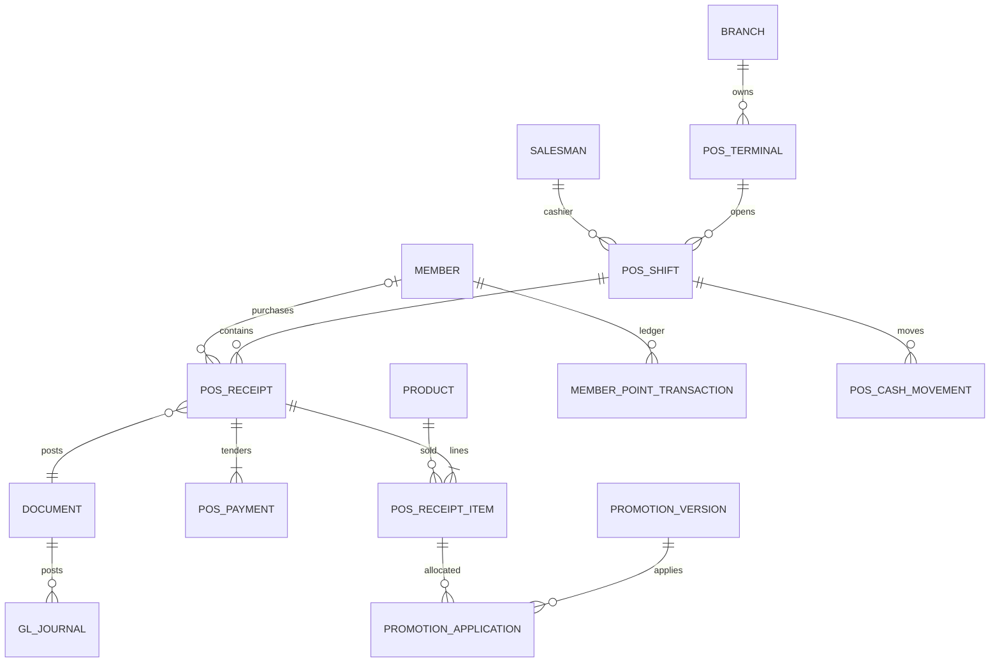

# วิเคราะห์ Business Plus POS เทียบ JET POS — 2026-11-06

## สรุปผู้บริหาร (หน้าแรก: ขอบเขตประมาณหนึ่งหน้าเมื่อจัดพิมพ์)

| ประเด็นตัดสินใจ | ข้อสรุป / สิ่งที่ต้องทำ |
|---|---|
| เป้าหมาย | ใช้แนวคิดกระบวนการของ Business Plus เป็นตัวเทียบ ไม่คัดลอก UI โค้ด หรือองค์ประกอบกรรมสิทธิ์; ต่อจาก `docs/ai/bplus-erp-analysis.md` เฉพาะส่วน POS |
| ฐานหลักฐาน | อ่าน source ณ HEAD `140deb0` branch `claude/bplus-erp-analysis`; ไม่ได้ยืนยัน binary ที่ร้านหรือ production; pull ถูกปฏิเสธการเขียน FETCH_HEAD จึงไม่อ้างว่าเป็น main ล่าสุด |
| ความขัดแย้งกับ brief | brief ระบุ Vue 1.8.1 ขายจริง / Python 0.8.7 UAT ให้ใช้เป็นบริบทจากเจ้าของ แต่ source นี้ Vue `package.json:4` เป็น 1.7.9; Python มีโปร 3 แบบ ไม่ใช่ 8 และไม่มี payments.py / shift_float.py / touch_dialogs.py ตามชื่อที่ brief ขอ ต้องรับ source/artifact ที่ตรงก่อนประเมิน parity |
| สิ่งที่มีแล้ว | ERP checkout, กะ/float/blind count/Z สองใบ, 5 method codes, stock/GL, points, device auth และ checkout replay; Vue local queue, 8 แบบโปร, hold/resume; Python Decimal, local sale/outbox, barcode, Windows printer/drawer มีฐานพร้อมต่อยอด |
| ความเสี่ยงเงินสูงสุด | ERP โปรรายสินค้าใช้บรรทัดแรก แต่ Vue รวมจำนวน; Vue ปันส่วนลดด้วย number/ราคาหน่วย 4 ตำแหน่ง; Python sync อ่าน payment แรก; GL ขายสดใช้ cash role แม้ receipt แยกช่องทาง ต้องพิสูจน์/แก้ก่อนขยายโปร |
| แนวทาง engine | ERP PosPricingGuard ชี้ขาดราคา; นิยาม rule/version/calculation contract เดียว ใช้ golden fixtures ERP/Vue/Python; เก็บ original sale snapshot และแผนย้าย 8 แบบโดยไม่ reprice บิลเก่า |
| สมาชิก/อุปกรณ์ | มี member/points/LINE login บางส่วน; birthday, expiration, tier lifecycle และ coupon engine ยังต้องออกแบบ; Windows default printer เป็นข้อเท็จจริงจากเจ้าของ การเปิด drawer ต้องทดสอบ driver/RAW จริง |
| ลำดับลงทุน | P0 parity/replay/ภาษี/stock/clearing → P1 engine+offline+reconciliation → P2 loyalty/hardware → P3 analytics; ไม่ย้าย installer จน restore คิวค้างและยอดบัญชีผ่าน |
| ข้อจำกัด | คลิปเปิดด้วย web ไม่ได้ ใช้สรุปเจ้าของเท่านั้น; php artisan test เริ่มไม่ได้เพราะไม่มี vendor/autoload.php; เป็นการตรวจ source ไม่ใช่รับรอง UAT/การปฏิบัติตามกฎหมายภาษี |

**ระดับแหล่งข้อมูล:** “จากคลิปตามสรุปเจ้าของ” = ยังไม่ได้ดูวิดีโอโดยตรง; “พบใน repo” = ระบุไฟล์:บรรทัด; “ตีความ” = ข้อสรุปเชิงวิเคราะห์; “ข้อเสนอใหม่” = ยังไม่ใช่ฟีเจอร์ที่ยืนยันว่ามี ระบบ production อาจใหม่กว่า snapshot นี้ ห้ามอนุมานกลับว่าร้านไม่มีฟีเจอร์นั้น

จากคลิปตามสรุปเจ้าของ: [วิดีโออ้างอิง Business Plus POS](https://www.youtube.com/watch?v=KMHKpqcdfKA) แสดงสแกน→ราคา→รวมยอด→เงินสด/บัตร→ลิ้นชัก→ใบเสร็จ, ค้น Member ID/สแกนบัตรพร้อมวันหมดอายุ/เกิด/ยอดซื้อ, โปรอัตโนมัติ (อ้างมากกว่า 35 แบบแต่ไม่แจกแจงครบ), ซื้อครบลด/แถม/3×35 ลดเหลือ100 และรายงานวัน/เงินสด/บัตร/ยกเลิก/คืนผ่านเครื่องพิมพ์ใบเสร็จ **ไม่ถือว่า 35 แบบเป็น specification ที่ตรวจแล้ว** ตีความ: จุดเด่นคือความต่อเนื่องของงานแคชเชียร์ ข้อเสนอใหม่ในเอกสารนี้มาจากโจทย์และความเสี่ยงของเรา ไม่อ้างว่า Business Plus ใช้ schema หรือบัญชีแบบเดียวกัน

## 1. POS Feature Gap Analysis

Existing = พบ implementation ตามขอบเขต; Partial = มีบางส่วน; Missing = ไม่พบในส่วนที่ตรวจ ไม่ใช่รับรองว่าไม่มีทั้ง repo; Risk = พบพฤติกรรมต้องพิสูจน์ก่อนใช้ รายการหนึ่งอาจมีทั้ง Existing และ Risk

| งาน | Vue | Python | ERP / หลักฐานจริง | Gap / Risk |
|---|---|---|---|---|
| scan/cart/unit | Existing `apps/pos-desktop/src/App.vue:251`, `:400` | Existing `apps/pos-python/pos_python/services.py:562`, `apps/pos-python/pos_python/ui.py:4497` | Existing `app/Http/Controllers/PosController.php:277`, `:578`; normalize `app/Services/Sales/PosPricingGuard.php:295` | ต้องแยกขายเป็นแพ็กกับ qty ฐาน และเก็บ original barcode |
| weighted 800/801 | Partial cart ชั่ง `apps/pos-desktop/src/App.vue:266` | Existing profile decoder `apps/pos-python/pos_python/barcode.py:50` | Existing `app/Services/Inventory/ScaleBarcodeService.php:37`, `app/Services/Sales/PosPricingGuard.php:39` | ป้ายราคารวม ≠ น้ำหนัก; ต้องทดสอบนำเข้า EAN/เช็กดิจิต/ศูนย์นำหน้า/ป้ายราคาเก่า ไม่พิสูจน์เครื่องจริงจาก decoder |
| โปร | Existing 8 รูปแบบ `apps/pos-desktop/src/lib/pricing.ts:44` | Partial 3 รูปแบบ `apps/pos-python/pos_python/promotions.py:49` | Existing 8 code values `app/Http/Controllers/QtyPromotionController.php:55` | Risk ERP firstWhere `app/Services/Sales/PosPricingGuard.php:417` แต่ Vue รวม qty `apps/pos-desktop/src/lib/pricing.ts:55`; Python ยึด first ตาม `apps/pos-python/pos_python/promotions.py:52` |
| ส่วนลดท้ายบิล/ผู้อนุมัติ | Partial ส่งชื่อคนขาย `apps/pos-desktop/src/App.vue:946` | Partial approval UI `apps/pos-python/pos_python/ui.py:4560` | guard `app/Services/Sales/PosPricingGuard.php:176`; verify approver `app/Http/Controllers/Api/PosApiController.php:176` | Risk ชื่อใน payload ไม่ใช่หลักฐาน PIN approval; ต้องผูก authorization ที่ server ตรวจได้กับยอด/บิล/expiry ไม่รับรองว่าทุกเส้นทาง bypass ได้โดยไม่ทดสอบ HTTP |
| payment | Existing cash/transfer/card/cheque/mixed `apps/pos-desktop/src/App.vue:234` | Partial UI cash/transfer `apps/pos-python/pos_python/ui.py:3383`; sync SELECT LIMIT1 `apps/pos-python/pos_python/sync_service.py:315` | Existing 5 codes `app/Http/Controllers/PosController.php:1096`; mixed สองแถว `:1579` | mixed จำกัด cash+transfer ไม่ใช่ arbitrary split; QR confirmation เป็นการยืนยัน ไม่ใช่ bank settlement ที่พิสูจน์แล้ว |
| member/loyalty | Partial find/select `apps/pos-desktop/src/App.vue:376` | Missing หน้าสมาชิกครบวงจรใน UI ที่ตรวจ | Existing `app/Models/Member.php:10`, `app/Services/Sales/MemberPointService.php:56` | ยังไม่ยืนยัน birthday/expiry/tier automation; points ต้องป้องกันแลกซ้ำข้ามเครื่อง |
| hold/resume/suspend | Existing online hold `apps/pos-desktop/src/App.vue:854`; cart persist `:386` | Missing หลายบิลพักใน UI ที่ตรวจ | Existing `app/Http/Controllers/PosController.php:842`, `:871`, `:924` | cart persist เดียวไม่เท่ากับ offline hold หลายใบ; resume lock มี แต่ต้อง UAT ไม่แทนที่ cart โดยไม่เตือน |
| void/refund/reprint | Existing `apps/pos-desktop/src/App.vue:278`, `:236` | Partial `apps/pos-python/pos_python/sync_service.py:357`, `apps/pos-python/pos_python/ui.py:4964` | Existing `app/Http/Controllers/Api/PosApiController.php:801`, `:837` | partial return ต้องอิงราคาหลังส่วนลดเดิม/ของแถม/แต้ม; พิมพ์ซ้ำไม่ post ใหม่ |
| local-first/retry | Existing queue ก่อนพิมพ์ `apps/pos-desktop/src/App.vue:953` | Existing `apps/pos-python/pos_python/sync_service.py:291` | Existing hash+replay `app/Http/Controllers/Api/PosApiController.php:583` | Vue needs_review ถูกเลือก retry อีก `apps/pos-desktop/src/lib/sync.ts:11`; clear/discard เปลี่ยนเป็น synced `apps/pos-desktop/src/lib/db.ts:277` ต้องแยกยกเลิกในเครื่องจากส่ง ERP สำเร็จ |
| shift/float/blind/Z | Existing close flow `apps/pos-desktop/src/App.vue:787` | Partial close `apps/pos-python/pos_python/services.py:469`; ไม่มี shift_float.py | Existing `app/Http/Controllers/PosController.php:728`, `:776`, `:1733`, `:1746`; Z `resources/views/pos/z-report.blade.php:38` | brief ว่า Python มี float แล้ว ยังยืนยันไม่ได้ใน snapshot; null carry ต้องไม่สร้างยอดขาดปลอม |
| printer/drawer/display | Partial window.print `apps/pos-desktop/src/App.vue:211` | Existing Windows print/raw pulse `apps/pos-python/pos_python/printers.py:11`, `:64` | ร้านใช้ Windows default printer ตามเจ้าของ | afterprint ≠ กระดาษออก; customer display/serial scale integration ยังไม่พบในส่วนที่ตรวจ |
| ERP stock/GL/report | client แสดงสถานะส่ง | client outbox | Existing `app/Services/Sales/CashSaleService.php:39`, `app/Services/Accounting/GlPostingService.php:293`; sales view `database/migrations/2026_08_23_000148_flag_legacy_pos_receipts.php:66` | Risk GL cash ทุก method; line discount ถูกเก็บ0 `app/Http/Controllers/PosController.php:1573` จึงไม่มี trace allocation แบบใหม่ |

อ่าน `docs/ai/task.md` แล้ว ค้น firstWhere/หลายบรรทัดพบแต่บันทึก UI/นำเข้า ไม่พบคำอธิบายบั๊กนี้ตรงตัวใน snapshot จึงยึดโค้ดที่ชี้ข้างต้นเป็นหลักฐานตรง ห้ามอ้าง handoff ว่าแก้แล้ว ทั้ง payments.py, shift_float.py, touch_dialogs.py ไม่มีใน directory นี้; อ่าน services.py/ui.py/printers.py ที่ทำงานใกล้เคียงแทนโดยไม่สร้างไฟล์เติม

## 2. POS Complete Workflow

**ข้อเสนอใหม่: state machine เดียวทั้งสามระบบ** draft → priced → tendering → locally_committed → pending_sync → ERP_posted; แยก needs_review, void_pending, reversed และ print_failed ออกจากสถานะเงิน บิลที่ commit แล้วห้ามย้อนเป็น draft แก้ยอดเอง

| ขั้น | กฎและขอบเขตผลข้างเคียง |
|---|---|
| เตรียมเครื่อง/กะ | Device Token บังคับ branch/terminal; cashier จาก PIN/session ไม่ใช่เจ้าของ token (`app/Http/Controllers/PosController.php:157`, `:181`); เปิดกะ terminal lock; offline ขายได้เฉพาะ policy/catalog/credential ยังใช้ได้ |
| Scan → Cart | แยก registered barcode ก่อน profile ชั่งตาม contract; เก็บ source_line_uuid, qty_sale, unit/factor snapshot, qty_base และ label ราคาเต็ม; scale ไม่เปิดแก้น้ำหนักที่ถอดแล้วโดยเงียบ |
| Member | ค้น code/card/QR เลือกชัด ปกปิดข้อมูลส่วนตัว; การเปลี่ยนสมาชิกทำให้ราคา/โปร/แต้มต้องคำนวณใหม่ |
| Promotion → Tax | deterministic engine ให้ breakdown ต่อบรรทัด; ERP เป็น authoritative; แสดง VAT/no-VAT ตามสินค้าและเล่ม ไม่ใช้ VAT รวมทุก SKU แบบ estimate เป็นยอดภาษีสุดท้าย |
| Payment | lock quote/version ระหว่างรับเงิน; cash ทอนเฉพาะ cash; card/QR แยก pending/confirmed/settled; arbitrary split เสนอใหม่ต้อง sum tenders = net; timeout payment provider ต้อง query transaction เดิม |
| Complete → Receipt | local transaction บันทึก sale+lines+tenders+outbox+print_job ก่อนล้าง cart; print เกิดหลัง commit; พิมพ์ไม่ออกยังเป็นบิลเดิมให้พิมพ์ซ้ำ; provisional receipt แสดงรอ ERP ไม่แอบใช้เลข ERP ปลอม |
| Inventory → Sync ERP | offline เป็น stock demand ชั่วคราว ไม่ใช่ central stock ที่ตัดแล้ว; เมื่อ ERP รับทำ document/receipt/stock/COGS/GL/points ใน transaction เดียวและคืน canonical totals; retry key เดิม |
| Hold / Suspend / Resume | hold ไม่ใช่ขาย ไม่ตัด stock/รับรู้รายได้; suspend session ล็อกหน้าจอและคง cart; resume ตรวจ version/expiry ใหม่ก่อนรับเงิน และมีสิทธิ์รับบิลข้าม cashier |
| Void / Refund | draft void แค่ audit; completed void/refund ต้อง approval+source linkage+reversal; partial refund ไม่เกินจำนวน/มูลค่าสุทธิที่ยังคืนได้ รวม pending approvals และ reverse points ตาม policy |
| Reprint / Close | reprint snapshot เดิมพร้อมคำว่าสำเนา; เปิด drawer เป็น hardware event มีผู้ทำ/เหตุผล; close นับ blind → preview → ยืนยัน → Z สองใบ; ห้ามปิดทั้งที่มีบิลค้างโดยไม่มีกระบวนการตรวจสอบ |

หลายสาขา/เครื่องต้อง namespace UUID, กำหนดเวลาขาย/เวลา server/เวลา post และเขตเวลา Asia/Bangkok แยกกัน อย่าให้เวลานาฬิกาเครื่องเลือกงวดบัญชีที่ปิดแล้วเอง กรณี host ล่ม/เครื่องดับต้อง resume จาก durable state ไม่สร้าง UUID ทดแทนบิลเดิม

## 3. POS ERD

ส่วน **มีจริง** อ้างความสัมพันธ์จาก `app/Http/Controllers/PosController.php:1533` และ services ด้านบน; ส่วน + คือ **ข้อเสนอใหม่** ไม่ใช่ migration ที่ทำแล้ว

| Entity / ชนิด | Key / invariant ที่เสนอเพิ่ม |
|---|---|
| receipt/line เดิม | + unique(device_id, sale_uuid), line_uuid unique ต่อบิล, sold_at/accepted_at/posting_date, original_payload_hash, currency, engine_version; snapshot list/net/VAT/UOM/factor/label/cost references ไม่อ่าน master ใหม่ตอน reprint |
| payment เดิม | + tender_uuid, provider_txn_id unique ตาม provider, cash_tendered/change/net, account/settlement_batch/status; ไม่เก็บ PAN/CVV; FK receipt และ refund_of_payment |
| + sale_operation / outbox | unique(device, operation_uuid), aggregate_uuid, sequence/dependency, command_type, immutable payload/hash, attempts/next_retry/error/code, server_response; แยกจาก print_job |
| + promotion/version | rule_id, version, schema_version, content_hash, status draft/published/retired, starts/ends/timezone, policy_version; published แก้ไม่ได้ |
| + condition/action/scope | version FK, JSON typed AST, effect/action sequence, scope branch/category/product/member/tier, exclusion/conflict group; unique rule/version |
| + application/allocation | receipt+line+rule_version+step, eligible_basis, consumed_qty, discount_minor, rounding_residual; reversal_of_application เก็บการคืน |
| + loyalty lots/reservation | member, earn_source unique, expires_at, remaining_points, redemption_uuid unique, reversal reference; append-only point events |
| + member card/verified identity | member FK, opaque card identifier/hash/status/expiry; LINE binding unique active sub ต่อ tenant มี verified_at/method/revocation audit |

เงินใช้ integer minor units หรือ decimal ที่นิยาม scale เดียว; qty/factor Decimal ไม่ใช้ float; FK/unique/check และ NULL ต้องรองรับ SQLite/PostgreSQL ทั้งคู่ แยก server IDs กับ local IDs แบบ Python (`apps/pos-python/pos_python/sync_service.py:304`) cashier ของ pos_shifts = salesman แต่ pos_receipts.cashier_id = user; ผู้ขายจริงคือ cashier_salesman_id (`app/Http/Controllers/PosController.php:1556`) ห้าม join สอง cashier_id เข้าหากัน

## 4. Promotion Rule Engine Design

ทั้งหมดในหัวข้อนี้เป็น **ข้อเสนอใหม่** เว้นส่วนเปรียบเทียบ source เดิม: ปัจจุบัน hardcode switch/if ใน `app/Services/Sales/PosPricingGuard.php:380`, `apps/pos-desktop/src/lib/pricing.ts:44`, `apps/pos-python/pos_python/promotions.py:49` จึงเพิ่มชื่อโปรทีละแบบและ parity เสี่ยง

### 4.1 Schema / conditions / actions

Rule document ตัวอย่างเชิงสัญญา: `{id:"bundle-A",version:2,schema_version:1,engine_version:"2",currency:"THB",timezone:"Asia/Bangkok",starts_at,ends_at,priority:100,conflict_group:"basket",stack_mode:"exclusive",conditions:{all:[{qty_base:{gte:"3"}},{branch:{in:[1]}}]},actions:[{type:"bundle_total",amount_minor:10000,consume_qty:"3"}]}`. Publish ต้อง validate schema, reference, cycles, scope, amount caps และ preview counterexamples; ไม่มี arbitrary script/eval

| ความต้องการ | Condition → action ที่ประกอบกันได้ |
|---|---|
| % / บาท | eligible net/qty/amount threshold → percent_discount / fixed_discount พร้อม cap |
| Buy X Get Y | qualifying units และ gift availability → add_gift หรือ discount_cheapest_units; ระบุ X นับรวม Y หรือไม่ |
| bundle / mix & match | product set/category, consume N → bundle_total/cheapest_free; ไม่ขยาย kg เป็นจำนวนชิ้นด้วย floor โดยไม่มี unit policy |
| quantity break / tiered | quantity intervals → unit_price override หรือ marginal tier discount; ระบุ all-units กับ marginal แยกกัน |
| member / birthday | verified member status/tier/group, birthday window/ครั้งต่อปี → ส่วนลด/แต้ม/ของแถม; leap day policy |
| coupon / voucher | token valid, usage/reservation/campaign remaining → discount หรือ tender ตามประเภทที่เจ้าของบัญชีอนุมัติ; ไม่ปน voucher liability กับส่วนลด |
| time / branch / category / group pricing | local calendar/time window, branch set, category snapshot, customer group → eligible scope/base price table ก่อนโปร |
| exclusion / priority / stacking | exclude SKU/ลดราคาอยู่แล้ว/ของแถม, conflict group, priority, stackable → candidate filtering และ resolution ที่อธิบายได้ |

### 4.2 Calculation contract / conflicts

1. normalize input: stable line_uuid, selling/base units, label overrides ที่ ERP ตรวจแล้ว, master/price/rule versions, member proof, sold_at ที่ policy อนุญาต; aggregate เฉพาะ promotion bucket ที่ product+unit/price/tax/eligibility เหมือนกัน เก็บ mapping คืนทุกบรรทัด ไม่รวมสินค้าชั่งคนละ label โดยสูญหลักฐาน
2. เลือก base price จาก group/branch/schedule ตามลำดับที่นิยามแน่นอน แล้ว evaluate conditions เป็น pure function ไม่อ่านเวลา/สุ่มเองใน calculator
3. คำนวณ candidates, จำกัด redemption และ consumed_qty: unit ที่ใช้ bundle แล้วห้าม free อีกหากไม่อนุญาต; exclusive group เลือก priority ก่อน จากนั้น benefit มากสุด แล้ว rule_id/version เป็น tie-break ที่คงที่ ไม่ทำ global best-price optimization โดยไม่กำหนดสัญญา
4. stackable ทำตามลำดับคงที่ item→basket→manual→points/card ตาม policy ที่ประกาศ; ระบุ percent คิดบน original หรือ remaining basis; cap ยอดลดไม่เกิน eligible remaining gross และไม่ซ้อนของแถมเป็นฐานซื้อครบ
5. allocate เฉพาะ eligible lines ด้วยสัดส่วน gross/net ตาม action; คิดหน่วยสตางค์แล้วแจกเศษแบบ largest remainder ผูก line_uuid เพื่อ sum allocations = discount ทุกครั้ง; VAT แยก taxable/exempt ตาม allocation จริง ไม่ปันของแถม/สินค้า excluded โดยอัตโนมัติ
6. VAT หลังส่วนลดต่อบรรทัดโดย ERP canonical algorithm; ส่งกลับ subtotal/discount/VAT/net และ calculation trace/hash; ต้องมี invariant net≥0, allocated qty≤eligible qty, sum tenders=net, sum VAT groups=receipt VAT

ตัวอย่าง **สมมติ** 3×35=105 bundle100 ลด5; สองบรรทัดสินค้าตัวเดียว qty1+2 ต้องได้100 ทั้งสาม engine ไม่ใช่ Vue100 แต่ ERP105. ตัวอย่างเศษ **สมมติ** สามบรรทัดฐาน1บาทเท่ากัน ลด1บาท: allocation0.34/0.33/0.33 ตาม stable ID; ราคาสุทธิ0.66/0.67/0.67 รวม2.00 ไม่ทำ0.33ทุกบรรทัดแล้วหาย1สตางค์ การคืนบรรทัดอ้าง allocation เดิม ห้ามคำนวณโปรใหม่กับราคาปัจจุบัน

ต้นทุน FIFO ของสินค้าขายและของแถมยังต้องตัดจริง ไม่ลดต้นทุนตามส่วนลดขาย; กำไร = net revenue ไม่รวม VAT − actual COGS รวมของแถม; รายงานโปรแยก funded discount/points/voucher/markdown ไม่รวมทุกอย่างเป็น promotion cost ซ้ำ

### 4.3 Authority / versioning / offline

ERP `PosPricingGuard` ต้องเป็น facade เรียก engine authoritative ไม่ให้ client ส่ง net แล้วข้าม guard; Vue/Python แสดง preview ตาม contract เดียว อาจใช้ shared compiled core หากพิสูจน์ portability ได้ หรือใช้ implementation ต่างภาษาพร้อม golden fixtures ชุดเดียว ต้องตรงระดับ line allocation/VAT ไม่ใช่แค่ grand total

Published version immutable, effective interval [start,end), timezone/rounding/unit policy อยู่ใน signed manifest/hash; offline download เป็น atomic snapshot พร้อม effective prices/products/tombstones และ retain เวอร์ชันที่มี pending sale. ข้อมูลหมดอายุให้จำกัดโปร/หยุด redemption ตาม policy แจ้งชัด ไม่ fallback ให้ส่วนลดเดาเอง; ERP ต้องตัดสิน historical eligibility จาก version ที่อนุญาตและเวลาขายที่ตรวจสอบได้ ไม่เชื่อ clock client อย่างเดียว ปัจจุบัน guard ตรวจฐานราคาใน server (`app/Services/Sales/PosPricingGuard.php:107`) ยังไม่ใช่ historical rule contract นี้

### 4.4 แผน migration โปรเดิมครบ 8 แบบ

| Legacy promo_type | Adapter → rule/action |
|---|---|
| free_item | qty threshold+repeat sets → gift SKU/free_qty |
| bundle_price | qty/min_qty → bundle total |
| discount | qty sets → percent/fixed บน units ที่เข้าเกณฑ์ |
| mix_bundle | product_ids set → N-unit bundle_total |
| mix_free | product_ids+X/Y → cheapest free โดย retain legacy selection |
| bill_discount | paid eligible amount threshold → basket percent/fixed+max_discount |
| bill_free_item | paid threshold → gift SKU/free_qty |
| bill_addon | threshold excluding addon → limited addon_qty at special price |

Phase M0 export/read-only snapshot legacy IDs+dates+branch+group, map legacy_id→version และ capture fixtures ทุกแบบ ไม่แก้ตารางเก่า; M1 ใช้ adapter engine_version=legacy-v1 รักษา first-line/rounding/ordering เดิมสำหรับบิลเก่าและคิวเดิม เก็บ original payload/receipt/tax ไม่ rewrite; M2 shadow evaluate กับ engine-v2 ที่รวม qty ถูกต้อง แสดง differences ให้เจ้าของยืนยัน ไม่เปิด switch ทั้งสาม runtime แบบแยกวัน; M3 publish future-effective versions ใหม่พร้อม client capability gate, drain/retain old queues, canary สาขาทดสอบ; M4 cutover หลัง fixtures+บัญชีตรง แล้ว rollback เปลี่ยน active manifest สำหรับบิลใหม่เท่านั้น ไม่ reprice หรือ delete บิลที่รับแล้ว การแก้ firstWhere คือ semantic change ต้องเปลี่ยน version ไม่ทำเงียบใน legacy replay

## 5. Membership / Loyalty / CRM

พบ member→customer/type/receipts/point transactions ใน `app/Models/Member.php:15`; earn/redeem lock member และ source document ใน `app/Services/Sales/MemberPointService.php:56`, reversal `:110`; discount card มี expiry/usage cap ใน `app/Models/DiscountCard.php:24`. LINE login ตรวจ ID token กับ LINE และหา active sub binding (`app/Http/Controllers/MemberPortalController.php:23`); coupons/rewards คืนรายการว่าง `:48` จึงไม่ถือว่ามี coupon engine แล้ว

| ข้อเสนอใหม่ | กติกาและเกณฑ์รับมอบ |
|---|---|
| master / member ID / card QR | customer เก็บหนี้/ภาษี, member เก็บสิทธิ์สะสม เชื่อม FK; card token opaque เปลี่ยน/เพิกถอนได้ ไม่ encode โทรศัพท์หรือสิทธิ์ที่แก้ได้; สแกนบัตรแสดงชื่อปกปิดก่อนเลือก |
| group / tier | groups สำหรับราคา, tiers สำหรับสิทธิ์; effective dates/upgrade/downgrade/ยอดคืนกระทบ tier ตามนโยบาย ไม่เปลี่ยนสิทธิ์ย้อนหลังในใบเสร็จ |
| birthday / expiry | เก็บวันเกิดด้วย consent/สิทธิ์เข้าถึง; expiry membership แยก expiry point lots; birthday redemption unique(member,campaign,year); สมาชิกหมดอายุ lookup ได้แต่สิทธิ์ใช้ตาม policy |
| earn/redeem/expire/history | append-only ledger+point lots ใช้ก่อนหมดอายุก่อน, earn หลัง net eligible ไม่รวม VAT ตามนโยบายที่เจ้าของเลือก; expiration event retry ไม่ซ้ำ; partial refund reverse ตาม original allocation; offline ให้ earn provisional แต่ห้าม redeem ข้ามเครื่องโดยไม่มี server reservation |
| credit limit | member ไม่ได้แปลว่าขายเชื่อได้; customer credit exposure รวม outstanding+approved commitments ตาม ERP policy; offline ไม่อนุมัติวงเงินใหม่; เปิด AR ผ่าน credit-sale flow ไม่สร้าง tender cash ปลอม |
| LINE OA binding | login พิสูจน์ LINE sub กับ provider แล้ว **ต้องพิสูจน์ความเป็นเจ้าของ member แยก** เช่น signed single-use invite จาก session สมาชิกที่ยืนยันแล้ว หรือให้เจ้าหน้าที่ตรวจพร้อม audit; ไม่ผูกจากเบอร์โทรอย่างเดียว; invite ผูก nonce/expiry/audience/member และ consume ครั้งเดียว; revoke/relink แจ้งเตือนเจ้าของ |
| CRM / privacy | purchase history ตามสิทธิ์สาขาและตัวตน, consent แยก marketing จากการเป็นสมาชิก, retention/export/delete ตามนโยบายที่อนุมัติ; ไม่ให้ cashier download ฐานสมาชิกทั้งหมดเพื่อ offline โดยไม่จำเป็น |

## 6. Hardware Integration

หลักฐานพิมพ์ Vue `apps/pos-desktop/src/App.vue:211` เรียก window.print และ comment kiosk-printing `:222` เป็นเพียงความตั้งใจใน source ไม่ยืนยัน Tauri ใช้ flag Chrome ได้จริง; Python Windows queue + RAW ESC/POS pulse `apps/pos-python/pos_python/printers.py:11` และ Qt print `:64` มีจริง แต่ไม่ได้ทดสอบ driver/ลิ้นชักร้านนี้

| อุปกรณ์ | Browser POS | Desktop Tauri / PySide6 | ข้อเสนอ local device service / UAT |
|---|---|---|---|
| USB/Bluetooth scanner | keyboard wedge ใช้ง่าย ต้อง focus/terminator; browser Bluetooth ไม่เท่ากับ keyboard pairing | wedge เหมือนกัน; native HID/serial ต้อง permission/driver | ทดสอบไทย/อังกฤษ, leading zero, scan burst, disconnected/repaired; allowlist อุปกรณ์ถ้า native |
| ESC/POS printer | print dialog/default printer; silent พึ่ง kiosk policy ที่ติดตั้งจริง | Tauri ต้อง native print bridge ที่รองรับ runtime; Python Qt/spooler มีจริง | Windows service รองรับ selected/default queue, job_id, 58/80mm, Thai glyph/cut; spooler accepted ≠ print physically complete |
| cash drawer | window.print ไม่ยืนยัน pulse; driver อาจเปิดตาม print ทุกครั้งรวม reprint | Python RAW pulse แยกได้ ต้องไลบรารี/queue/port ถูก | drawer job unique per sale/action; reprint default ไม่เปิด; no-sale open ต้องสิทธิ์+เหตุผล; offline/retry ไม่เปิดซ้ำอัตโนมัติ |
| customer display | secondary browser window fullscreen อาจโดน popup/block/sleep | native second screen ง่ายขึ้นแต่ต้อง mapping display | แสดง net/pay/change/sync ไม่โชว์ PIN/ข้อมูลส่วนตัว; disconnect ไม่ขัด checkout |
| เครื่องชั่ง | barcode label reader ทำได้; serial/web APIs ขึ้นกับ browser | native serial อ่าน live weight ได้เมื่อรองรับ protocol | แยก label decoder กับ live scale; stable/tare/unit/status/calibration; ไม่ใช้เลขจากเครื่องที่ยังไม่นิ่ง |
| touchscreen | responsive/focus/virtual keyboard | จัด layout เหมือนกันแต่ DPI/native dialogs ต่าง | UAT 1024×768, scaling125/150%, glove touch, double tap และ scanner ระหว่าง modal |

หากใช้ local service ให้ bind loopback, authenticated origin+short-lived command authorization, signed installer, จำกัด printer/drawer commands ไม่เปิด arbitrary file/shell/RAW จากเว็บใดก็ได้; เก็บ print snapshot/job status แยก sale. ร้านใช้ Windows default printer ตามเจ้าของ จึงเริ่มจากยืนยัน queue/driver ที่ใช้จริงและทดสอบพิมพ์ไทย+ตัดกระดาษ+drawer ไม่บังคับเปลี่ยนทั้งหมดเพื่อสถาปัตยกรรมใหม่

## 7. Offline Sync

ปัจจุบัน Vue SQLite schema/cache/queue `apps/pos-desktop/src/lib/db.ts:19`, `:23`, promotion cache `:223`, sync `apps/pos-desktop/src/lib/sync.ts:7`; enqueue ก่อนพิมพ์ `apps/pos-desktop/src/App.vue:953`. Python มี event sync เปิดกะ/เงินเข้าออก/ปิดกะ/ขาย/void (`apps/pos-python/pos_python/sync_service.py:183`, `:220`, `:248`, `:291`, `:357`). ERP idempotency transaction+payload hash `app/Http/Controllers/Api/PosApiController.php:601`, `:616`, rejected review `:681`

| ข้อเสนอ protocol | Invariant / recovery |
|---|---|
| local atomic commit | sale+items+tenders+outbox อยู่ SQLite transaction เดียว; receipt job อีก state; disk full/DB lock ต้องไม่แจ้งสำเร็จหรือทิ้ง cart |
| replay | UUID เดิม+payload hash เดิม → response เดิม; UUIDเดิมต่าง payload →409 review; server crash หลัง commit ก่อน response query status/retry เดิม ห้าม UUID ใหม่ |
| dependency order | auth/cashier→shift_open ack→sale/cash/void→shift_close หลังรายการก่อนหน้าถูก ack; sequence ต่อ aggregate ป้องกัน close แซง sale; ข้ามเครื่องต้อง server lock |
| error classes | timeout/429/5xx backoff+jitter; 401/403 หยุด auth ไม่ทิ้งคิว; 409 แยก processing/hash/stale; 422 needs_review ไม่วนส่งอัตโนมัติจนถี่; เก็บ original+error+ผู้ตัดสิน |
| stale catalog / promo / clock | cache watermark/hash+versions+revocations; แจ้ง freshness; retained historical versions รับเฉพาะช่วง policy ที่อนุมัติ; ห้ามแก้ payload ราคาเก่าเพื่อให้ผ่านโดยไม่มี compensating record |
| offline restrictions | จำกัด credit, coupon single-use, points redemption, refund ข้ามเครื่อง, card/QR ที่ตรวจเงินเข้าไม่ได้; policy ระบุวงเงินและระยะเวลาชัดเจน ห้าม UI บอก settled จากการ tick อย่างเดียว |
| restore/cutover | encrypted backup+integrity, restore isolated ที่มี pending sale/void/shift_close; device identity/UUID ไม่สร้างซ้ำและไม่ replay กะที่ปิดแล้วเป็นขายใหม่; reconcile IDs สอง clientก่อนย้าย |

Risk เพิ่ม: `apps/pos-desktop/src/lib/db.ts:277`/`:284` ใช้ synced เป็นสถานะ discard/clear ทั้งที่ไม่ได้แปลว่า ERP post แล้ว; `apps/pos-desktop/src/lib/pricing.ts:160` ซ่อม discounted payload ตอนส่ง ต้อง freeze migration transform/version/hash และเก็บ original ไม่ให้ retry payload เดิมเปลี่ยนตาม code ใหม่. เสนอ state discarded_local พร้อม maker/checker/reason และ reconcile ว่ามีการรับเงินจริงหรือไม่; ไม่มีปุ่มล้างเพื่อทำให้ยอดค้างหายจากรายงานโดยไร้หลักฐาน

## 8. POS → ERP Accounting Mapping

**สิ่งที่พบจริง:** cash sale เรียก stock/cost/GL (`app/Services/Sales/CashSaleService.php:39`); VAT ต่อสินค้า/no-VAT book (`app/Services/Accounting/GlPostingService.php:148`), receipt ใช้ VAT จากเอกสารไม่เชื่อ client (`app/Http/Controllers/PosController.php:1543`); GL cash sale debit cash ทุกบิล (`app/Services/Accounting/GlPostingService.php:293`), COGS `:249`; cashbook ลง POS ตอน close (`app/Services/Accounting/CashBookPostingService.php:93`) ไม่ใช่ทุกบิล (`app/Services/Sales/CashSaleService.php:114`). **Risk:** ช่องทางรับเงินใน pos_payments จึงไม่พิสูจน์ว่า GL ถูก bank/card clearing แล้ว; ต้อง trace/ทดสอบ end-to-end ก่อนสรุปยอดธนาคารถูก Cashbook ไม่ใช่ GL ใหม่และปิดกะไม่ควรลงรายได้ซ้ำ

ตารางถัดไปเป็น **ข้อเสนอ mapping เป้าหมายและตัวเลขสมมติเท่านั้น** ใช้ VAT7% เพื่ออธิบายคณิตศาสตร์ ไม่ใช่คำวินิจฉัยกฎหมาย/อัตราที่ควรใช้จริง ต้องให้เจ้าของบัญชี/ภาษีรับรอง policy บัญชี voucher/points/ของแถมก่อนพัฒนา

สมมติ gross taxable107 + exempt50 =157 ลดท้ายบิล15.70 กระจาย10.70/5.00 → taxable96.30 (ฐาน90,VAT6.30) + exempt45 → net141.30 รายได้135.00; ต้นทุนรวม80.00

| Event / สมมติ | Debit | Credit | ผล subledger / กันซ้ำ |
|---|---|---|---|
| ขายจ่ายสด60+QR81.30 | Cash60; Bank/QR clearing81.30 | Sales135; VAT output6.30 | receipt/payment allocations; stock OUT+FIFO80; UUID sale เดียว |
| COGS ของบิลเดียวกัน | COGS80 | Inventory80 | stock ledger/cost layer ผูก document-line รวม gift ด้วย |
| บัตรแทน QR (อีกกรณี) | Card settlement clearing141.30 | Sales135; VAT6.30 | ไม่ถือเป็น cash ในลิ้นชัก |
| settlement บัตร ค่าธรรมเนียม3 (สมมติไม่มีภาษีค่าธรรมเนียมในตัวอย่าง) | Bank138.30; Fee expense3 | Card clearing141.30 | provider batch unique; statement matched; ไม่ลงยอดขายใหม่ |
| ขายเชื่อ net141.30 ผ่าน credit flow | AR141.30 | Sales135; VAT6.30 | customer open item141.30 และวงเงิน; ภายหลัง Dr Bank / Cr AR ไม่ขายซ้ำ |
| คืนทั้งบิล cash/QR เดิม | Sales returns135; VAT output6.30 | Cash60; Bank/refund payable81.30 | source receipt/refund payment; paid refund แยกจาก approved payable |
| รับคืนขายต่อได้ ต้นทุนเดิม80 | Inventory80 | COGS80 | original lot/cost reference; ของเสียไป quarantine/expense ตาม policy ไม่ใส่ขายได้ทันที |
| void posted | กลับด้าน journal ต้นทาง | กลับด้าน journal ต้นทาง | `app/Services/Accounting/GlPostingService.php:345`; reversal unique ห้ามลบประวัติ |

ยอด debit=credit ในทุกแถว รายได้/VAT ไม่ได้ลดซ้ำอีกบรรทัดเพราะส่วนลดหักจากราคาสุทธิแล้ว; หากต้องการแสดง contra revenue ต้องเปลี่ยน presentation contract โดย net ยังคงเดิม การขายพร้อม gift ราคา0 ยังมี COGS ของ gift; นโยบายภาษีของแถมต้องให้ผู้รับผิดชอบกำหนด ไม่อนุมานจาก zero price

กะตัวอย่าง **สมมติ** opening2000 + cash net sales6000 + cash_in100 − drop3000 − payout100 = expected5000; counted4990 → short10; kept2000 → deposit2990. Float carry/deposit ไม่ใช่รายได้ใหม่; เมื่อนำเงินจริงฝากธนาคาร Dr Bank2990 / Cr Cash2990 เมื่อมีหลักฐาน transfer ไม่ใช่แค่เลขซอง; ถ้ารับรู้ shortage ใช้ Dr cash shortage10 / Cr Cash10 ตามนโยบายที่อนุมัติ ต้องไม่ลงซ้ำทั้ง journal adjustment กับ movement ที่แทนกัน

แต้ม: ERP ledger earn/redeem มีแล้ว แต่การรับรู้ loyalty liability/การจัดสรร transaction price **ยังไม่ได้พิสูจน์ว่ามี** ต้องกำหนดกับบัญชีก่อน เช่น voucher ที่รับเงินล่วงหน้า Dr Cash / Cr Voucher liability ตอนขายบัตร และ Dr Liability ตอนใช้ ไม่ใช่ลดรายได้ซ้ำ; อย่าใช้ตัวอย่างนี้ตัดสินว่า points ทุกชนิดมี accounting เดียวกัน

sales ledger/profit dashboard อ่าน `sales_postings` (`database/migrations/2026_08_23_000148_flag_legacy_pos_receipts.php:66`) ไม่ union POS+cash-sale ซ้ำ; เพิ่ม promotion_application fact+member point links และ as-of pending offline; reconcile stock lots=inventory value, COGS journal=cost movement, receipt net=payments, tax group=VAT journal, cashbook=shift cash movements โดยแยกเวลา close/post/settlement

## 9. UI/UX Screens — touchscreen 1024×768

**ข้อเสนอใหม่** ใช้ safe viewport ไม่คิดรวม OS taskbar; font16–18px ปุ่มหลักอย่างน้อย48×48px, spacing8px, focus scan คืนหลังปิด modal; ห้ามทำงานสำคัญพึ่ง hover สีอย่างเดียวหรือเมนูคลิกขวา

| จอ / พื้นที่เสนอ | ข้อมูล / interaction / state |
|---|---|
| ขายหลัก | top64px branch/terminal/cashier/shift+ERP/catalog/queue แยกสถานะ; body560px cart480px + catalog544px, footer144px รวมยอด/โปร/VAT/ชำระ; ความสูงรวม768; cart scroll ของตน ไม่ดันปุ่มชำระหาย |
| Scan/cart | scan field sticky, unknown barcode ไม่กลายเป็นสินค้า0บาท; line แสดง qty/unit/price/net/promo/gift/label lock; numpad slide-over ไม่บัง total; แก้ qty แล้ว reprice ชัด |
| สมาชิก | modal ไม่เต็มจอ ค้น code/card/QR/ชื่อ มีหลายผลต้องเลือก; วันเกิด/หมดอายุ/แต้มเฉพาะที่มีสิทธิ์; network error ไม่แสดง “ไม่มีสมาชิก” |
| โปร/ส่วนลด | drawer แสดง applied/rejected reason, cap/exclusive group, breakdown ต่อ line; manual discount ต้อง approval; ผู้อนุมัติไม่เห็น PIN ใน receipt/log |
| ชำระ | total ใหญ่, cash/tender rows, change, remaining; QR pending/confirmed แยก; confirm disabled ระหว่าง durable commit และกัน double tap; split unsupported ต้องแจ้ง ไม่แปลงเงียบ |
| หลังรับเงิน | receipt no + provisional/posted + print status; print fail มี retry บิลเดิม; ไม่ให้ปุ่มลองใหม่สร้าง sale ใหม่; change ค้างจนแคชเชียร์ยืนยัน |
| พักบิล/ประวัติ | list ตามสิทธิ์/เจ้าของ/อายุ; resume เตือน cart เดิมและ expired promo; reprint, refund แยก action/permission; offline ไม่แกล้งแสดง central hold ว่าง |
| กะ/เงินสด/Z | เปิดกะนับจริง+เหตุผลต่าง; blind close ไม่ prefill expected; preview หลังนับ+float+bag ref; ยืนยัน close ก่อน Z สองใบ; Z open shift จำกัดสิทธิ์ |
| คิว/อุปกรณ์ | count/age/error/correlation ID, review ผู้มีสิทธิ์, export หลักฐานที่ redact secrets; แยก connected/catalog incomplete/queue pending; print test/drawer test ไม่สร้างยอดขาย |

ทุกจอทดสอบ loading/empty/error/offline/stale/permission denied/restart; แม้พื้นที่ 1024×768 ต้องไม่มี horizontal scroll ในทางขายหลัก แสดง keyboard mode และ screen lock ที่ไม่สูญเสียบิล

## 10. API Endpoints

**มีจริงทั้งหมดในกลุ่ม `/api/pos`** `routes/api.php:16` ใช้ pos.device; pair แยก throttle `routes/api.php:14`. อ่าน route จริงไม่สร้าง endpoint สมมติปน

| กลุ่ม | Endpoints ที่มี / หลักฐาน |
|---|---|
| device/auth | POST /pair; GET /ping,/cashiers; POST /cashier/login,/approver/verify,/cashier/pin,/auth-events,/admin/authorize (`routes/api.php:14`, `:17`) |
| catalog/price/member | GET /products,/promotions,/members,/members/search,/members/{member}; POST /scan,/members,/discount-card/check (`routes/api.php:24`, `:36`) |
| shift/cash | GET /shift; POST /shift/open,/shift/close,/shift/cash-movement (`routes/api.php:32`); close preview เป็น payload flag ไม่ใช่ GET endpoint แยก |
| hold/checkout/return | GET+POST /held-bills; POST /held-bills/{heldBill}/resume,/checkout,/receipt/void,/receipt/return (`routes/api.php:37`) |
| member portal | POST /api/member/auth/liff; GET /api/member/me/points,/point-history,/coupons,/rewards,/purchases (`routes/api.php:46`) ใช้ session/member auth ไม่ใช่ POS token |

| **เสนอใหม่** endpoint | Contract / authority |
|---|---|
| GET /api/pos/v2/catalog-manifest | snapshot_id, versions, hash, effective dates, watermark, tombstones; atomic download+ack |
| POST /api/pos/v2/price-quotes | cart/member/rule versions→quote_id, expiry, canonical line allocations/tax, trace; quote ไม่ post; server actor/branch จาก auth |
| POST /api/pos/v2/checkout | operation_uuid, quote/version, original sold_at, lines+tenders decimal strings→receipt/document/posting IDs+canonical totals; verify quote/hash/approval, same DB transaction |
| GET /api/pos/v2/operations/{uuid} | scoped device/branch status+cached response สำหรับ lost response; ไม่เปิดข้อมูลเครื่องอื่น |
| POST /api/pos/v2/returns | source_line_uuid+qty+refund_tenders+approval proof; original allocation+cost+point reversal; unique refund operation |
| POST /api/pos/v2/loyalty/reservations | online redeem/coupon reserve TTL, consume/release idempotent; ไม่อนุญาต client กำหนดยอดแต้มคงเหลือ |
| POST /api/pos/v2/reviews/{uuid}/resolve | maker/checker, reason+compensation refs; retain original payload/hash; ไม่แก้บิล accepted |

ตัวอย่าง command **เสนอใหม่** `{operation_uuid,engine_version:"2",rule_snapshot_id,lines:[{line_uuid,product_id,qty:"3.0000",unit_id,barcode}],tenders:[{tender_uuid,method:"cash",net:"100.00",received:"120.00",change:"20.00"}]}`. ไม่รับ user/branch/GL account จาก client เป็น authority; money scale/rounding/schema_version ต้องอยู่ OpenAPI. 200/201 replay ผลเดิม, 401/403 auth stop, 409 conflict, 422 review, 429/5xx retry UUIDเดิม; approval proof ต้อง scoped action+amount+cart hash+expiry ไม่ใช่ชื่อผู้อนุมัติลอย ๆ; old API คง compatibility window จนคิวเก่าหมด

## 11. Test Scenarios + Acceptance Criteria

**รอบนี้:** `php artisan test` exit255 เพราะไม่มี vendor/autoload.php ไม่ได้ติดตั้ง dependencies/รันทดสอบกับฐานจริง; ผลใน handoff เก่าไม่ใช่ผลรอบนี้ การตรวจนี้ไม่แก้ code/tests. ตารางเป็นแผนทดสอบสำหรับ implementation รอบถัดไป ใช้ isolated data เท่านั้น

| Priority / กรณี | Acceptance criteria ที่วัดได้ |
|---|---|
| P0 duplicate-line promo | 35×(1+2), bundle100: ERP/Vue/Python ได้ net100 และ line allocation เดียวกัน; legacy-v1 replay ไม่เปลี่ยนยอดเดิม |
| P0 golden promotions | ทั้ง8legacy + %,บาท,BXGY,mix,qty break,tier,birthday,coupon,time,branch,category,group/exclusion/stacking; line/tax/trace ตรงทุก runtime ทุกครั้ง รวม threshold±0.0001, จำนวนเศษkg, gift unavailable |
| P0 rounding/tax | ตัวอย่าง157→141.30 ในข้อ8 ตรง receipt/document/GL; 1บาทหาร3 allocation รวม1บาท; VAT+exempt/no-VAT book/ภาษีหลังส่วนลดและคืนบางส่วนไม่ต่างแม้0.01 |
| P0 checkout replay | ส่งพร้อมกันสอง request UUIDเดียว, lost response, server crash หลัง stock ก่อนGL; เกิด receipt/stock/GL/points ชุดเดียวหรือ rollbackทั้งหมด; payloadต่าง409 ไม่ทับ original |
| P0 authority/security | HTTP middleware จริง+request binding; forged branch/cashier/closed shift/approval string/ข้ามเครื่อง/expired PIN credential ถูกปฏิเสธ; salesmanกับuserคนละ ID ยังลงคนขายถูก |
| P0 payments/accounting | cash/card/QR/cheque/mixed และเสนอ multi-tender: tender sum=net, change เฉพาะcash; GL debitถูก clearing ไม่ใช้cashแทนcard; provider callbackซ้ำไม่รับเงินซ้ำ; Python ห้ามหล่น payment แถว2 |
| P0 stock/UOM/scale | pack factor, 0.375kg, price-label800/801, checksumผิด, EANนำเข้า, PLUเก่า/ราคาเปลี่ยน; qty_base/label amount/costถูก; ไม่เปลี่ยนqtyชั่งเพราะ merge line |
| P0 void/refund | refundบางส่วน/ซ้ำ/สองเครื่องพร้อมกัน/ของแถม/discount/แต้ม/งวดปิด; cumulative refund≤original netและqty; lot/COGS/VAT reverseตามต้นทางและ approvalครบ |
| P0 shift | opening variance เหตุผล, first/null carryไม่bookขาดปลอม, carry0ไม่fallback, blind APIไม่รั่วexpected; previewไม่เขียน; counted<defaultเตือน; close fail cashbook rollback; closeซ้ำไม่postซ้ำ; Z2ใบตรงยอด |
| P1 offline/restart | ตัดเน็ต/disk full/ดับหลังlocal commit/ค้างก่อนshift ack/closeแซงsale/restorebackup; คิวไม่หาย/UUIDเดิม, reviewไม่retryถี่, status discarded≠posted; queue totals reconcile central |
| P1 loyalty | สมาชิก2เครื่อง redeemพร้อมกันไม่ติดลบ; expiredlot/partialrefund/replayถูก; LINE subไม่ตรง/เบอร์โทรตรงแต่ไม่มีproofไม่ผูก; couponใช้ครั้งเดียว concurrencyถูก |
| P1 hardware/UI | 1024×768+125/150%DPI ไม่บังpay; scanburst/doubletapไม่ขายซ้ำ; printeroffline/outofpaper/driverไม่รองรับRAWแสดงผิดพลาด; reprintไม่post/เปิดdrawerซ้ำ; Thai58/80mmอ่านได้ |
| P1 reports/settlement | Z/payments/cashbook/GL/bankstatement/stocklot/sales_postingsตรง ไม่มีPOS+documentซ้ำ; pendingofflineแสดงas-of; promotion profitรวมgiftCOGS |
| P1 migration/rollback | legacy fixturesทั้ง8+pendingqueueเก่า+heldcartเก่า replayตามversionเดิม; rollbackmanifestไม่แก้บิลaccepted; upgrade/constraints/locksผ่านSQLiteและPostgreSQL |

ต้องมี unit golden fixtures, service transaction/fault injection, real HTTP auth, PostgreSQL concurrency สอง connection และ Windows hardware UAT; SQLite ไม่รับรอง row lock ของ PostgreSQL. Release gate: ไม่มีผลต่างเงิน/stock/VATที่อธิบายไม่ได้, cash/bank/stock reconciliationผ่าน, restore pendingqueueผ่าน, ตัว binary/version/installer ตรง source, เจ้าของบัญชี/ร้านลงนาม UAT; ไม่มีการ deploy ในงานเอกสารนี้

## 12. Development Roadmap

| ลำดับ | Deliverable / dependency | Gate ก่อนทำขั้นถัดไป |
|---|---|---|
| 0 P0 baseline | รับ source/artifact Vue1.8.1/Python0.8.7 ที่ตรงร้าน, catalog+price+CoA snapshots, ยืนยันวิธีขาย/ภาษี/โปร/ลิ้นชักจริง; แก้ข้อขัดแย้งความจำกลางด้วยงานแยก | ระบุ matrix branch/commit/binary/API capability และ fixtureฐานที่เจ้าของรับรอง |
| 1 P0 correctness | ERP firstWhere semantics/version, allocation+VAT decimals, approval proof, replay/stock/GL atomicity, cash/card/QR clearing, Pythonหลายpayment | P0ทุกกรณีข้อ11ผ่านบนERP+clientที่จะใช้จริง; ไม่เพิ่มโปรเพื่อกลบยอดไม่ตรง |
| 2 P1 engine migration | schema/AST+publish/version+adapter8แบบ+golden suite+shadow+canary; offline manifestและoperation status | oldqueueไม่เพี้ยน, parityระดับline/taxครบ, rollbackmanifestทดสอบ; ERPguardยังauthority |
| 3 P1 operational offline | durable sale/outbox/print jobs, reviewแทนclear, hold/suspend,กะfloat/blind/Z,refund/reconciliation reports | powerfail/restore/closedshift/refundและcashbook/GLreconcileผ่าน |
| 4 P2 member/hardware | membercards/tier/expiry/verifiedLINE, pointlots/reservations/coupons, Windowsprint/drawer/display/scale | privacy/auth/redeem concurrency + hardwareจริงที่ร้านผ่าน; ไม่เปลี่ยนinstallerก่อนmigrationlocalครบ |
| 5 P3 analytics | promotion usage/discount reasons/cashier performance/profit dashboard, settlement aging, CRM campaigns | dashboarddrillถึงline/postingได้, แยกofflinepending/settled, ไม่วัดperformanceจากยอดขายอย่างเดียวจนจูงใจข้ามcontrol |

แต่ละงานต้องมี owner, scope, dependency, fixture, test/rollback/handoff ก่อนประเมิน effort ไม่กำหนดวันเสร็จจากจำนวนฟีเจอร์ ธุรกรรม/เงิน/สต๊อก/ภาษีมาก่อนหน้าจอและจำนวนโปร. Deployment ต้องเป็นคำสั่งเจ้าของแยกต่างหากและใช้ docs/OPERATIONS.md

### บันทึกส่งมอบงานเอกสารนี้

- อ่าน PROJECT_MEMORY.md, WORKFLOW.md, brief, task.md, เอกสาร ERP ก่อนหน้า และ source ที่อ้าง; ไม่แก้ code/migration/production ไม่ออก PIN/token
- เขียนเฉพาะ `docs/ai/bplus-pos-analysis.md`; brief ที่มีอยู่จะรวม stage ตามคำสั่ง “commit brief นี้ด้วย” แต่ไม่แก้ brief และไม่แตะ `docs/ai/bplus-erp-analysis.md` หรือ task.md ของงานอื่น
- Pull ไม่สำเร็จ: Git metadata อยู่นอกขอบเขตเขียนได้ ถูกปฏิเสธ FETCH_HEAD; คง branch ปัจจุบันตามคำสั่งล่าสุดของเจ้าของ
- ตรวจเอกสาร: รายละเอียดผลตรวจอ้างอิง/whitespace และ commit/push บันทึกท้ายไฟล์หลังรันจริง; ไม่กล่าวอ้าง test suite ผ่าน
- ผลตรวจ: ครบหัวข้อ1–12; ตรวจอ้างอิงแบบ path:line เต็ม84แห่งว่ามีไฟล์/บรรทัดจริง หลังแก้ชื่ออ้างอิงย่อผ่านทั้งหมด; อ้างอิง `:เลข` ที่ต่อจากไฟล์เดียวกันอ่านตามบริบทในตาราง ตรวจ whitespace ของไฟล์ใหม่โดยตรงและ git diff --check ผ่าน
- Stage ไม่สำเร็จ: `git add -- docs/ai/bplus-pos-analysis.md docs/ai/codex-bplus-pos-analysis-brief.md` ถูกปฏิเสธสร้าง index.lock ใน Git metadata นอก workspace; ลอง commit เฉพาะสองไฟล์แล้วไม่สำเร็จเพราะยังเป็น untracked จึง **ไม่มี commit ใหม่**
- Push: `git push origin HEAD` คืน Everything up-to-date พร้อม remote-tracking update_ref lock error; ไม่มี commit ของสองไฟล์ให้ส่ง จึง **analysis และ brief ยังไม่ได้ push** คงไฟล์ทั้งสองไว้ใน workspace ตามคำสั่ง ไม่พยายามข้ามสิทธิ์หรือเปลี่ยน Git metadata

---
**หมายเหตุผู้ตรวจ (Claude, 2026-11-06):** เอกสารนี้อ่านจาก `main` ซึ่งยังไม่มีงาน Python POS ล่าสุด งาน Python อยู่บน branch `claude/pos-python-settings-popup` (0.8.7: โปร 8 แบบ, `payments.py` 5 วิธี, `shift_float.py`, `touch_dialogs.py`) ข้อสรุปเรื่อง Python ในตาราง Gap จึงเก่ากว่าของจริง ต้องประเมินซ้ำจาก branch นั้น ส่วน Vue `package.json` ยังเป็น 1.7.9 เพราะ workflow release ใส่เลขเวอร์ชันตอน build (1.8.1 ออกจริงแล้ว 6 พ.ย.)
